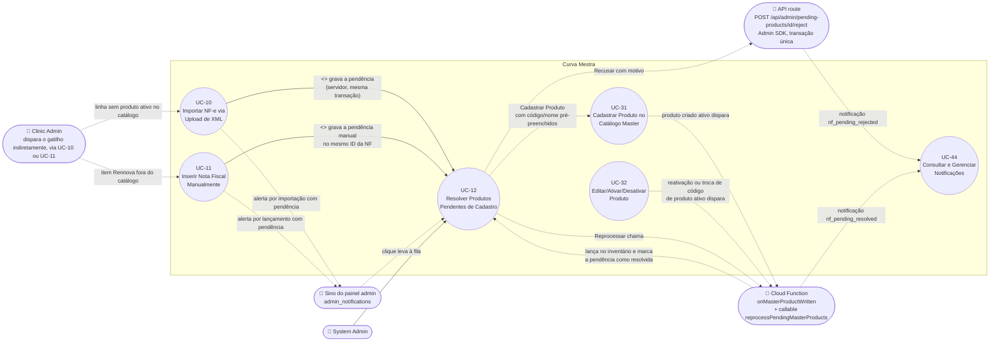

# UC-12: Resolver Produtos Pendentes de Cadastro

**Projeto:** Curva Mestra
**Data de Criação:** 14/07/2026
**Autor:** Guilherme Scandelari (via uml-use-case-writer)
**Status:** Aprovado
**Módulo/Contexto:** Inventário
**Versão:** 2.1

> Quando uma linha de uma NF-e importada via XML (UC-10) não tem produto ativo no catálogo master, ela vira uma pendência visível ao System Admin em `/admin/pending-products`. **[v2.0, BUGFIX-identidade-e-duplicidade-nfe, PR #393]** A resolução passou a ser automática: assim que o produto fica ativo no catálogo (cadastrado ativo, reativado ou com o código alterado estando ativo), a Cloud Function `onMasterProductWritten` lança as linhas pendentes daquele código no inventário de **todas** as clínicas afetadas, marca cada pendência como `resolvida`, atualiza o registro da importação e notifica a clínica. Na tela, o admin cadastra o produto ("Cadastrar Produto", com código e nome pré-preenchidos) e pode disparar a mesma incorporação manualmente com "Reprocessar", que substituiu "Marcar Resolvido". **[v2.1, FEAT-pendencias-nfe-fora-padrao-manual-recusa-checagem, PRs #396/#397]** As pendências passam a vir também do lançamento manual Rennova (UC-11), com a coluna "Origem" (XML/Manual), e a incorporação automática cobre as duas origens. O admin pode **recusar** qualquer pendência aberta com motivo (5 a 500 caracteres): a pendência vira `recusada`, a NF registra o item em `produtos_recusados` e a clínica recebe a notificação `nf_pending_rejected`. Os códigos fora do padrão do catálogo ficam numa seção própria, agrupados por código, só com "Recusar". Cada importação ou lançamento com pendência gera um alerta no novo sino do painel admin (`admin_notifications`), que leva a esta tela.

---

## 1. Diagrama UML (Mermaid)

---

## 2. Atores

### 2.1 Ator Primário
**System Admin**, único role com acesso a `/admin/pending-products` (`ProtectedRoute allowedRoles: ['system_admin']`, layout do grupo `(admin)`) e o único que lê `pending_master_products` pelas rules. O callable `reprocessPendingMasterProducts` também exige `is_system_admin == true`. **[v2.1]** A rota de recusa exige `is_system_admin === true` e `active === true` no token; os alertas de `admin_notifications` só são lidos pelo system_admin.

### 2.2 Atores Secundários / Sistemas Externos
- **Cloud Function `onMasterProductWritten`** (`onDocumentWritten('master_products/{productId}')`, região `southamerica-east1`): ator de sistema que executa a incorporação automática quando um produto fica ativo no catálogo (RN-07, RN-09).
- **Cloud Function callable `reprocessPendingMasterProducts`** (região `southamerica-east1`): executa a mesma incorporação sob demanda, pelo botão "Reprocessar" (RN-08).
- **[v2.1] API route `POST /api/admin/pending-products/[id]/reject`** (Admin SDK): executa a recusa numa transação (`rejectPendingProduct`, `src/lib/services/pendingRejectionServer.ts`). O tenant vem da própria pendência, nunca do corpo (RN-12).
- **[v2.1] Sino do painel admin (`AdminNotificationBell`):** mostra os alertas da coleção de raiz `admin_notifications`, criados pelo servidor nas transações de UC-10 e UC-11 (RN-15).
- **Clinic Admin:** não interage com esta tela. É quem, ao confirmar uma importação XML (UC-10) com linhas fora do catálogo ou, **[v2.1]**, ao salvar um lançamento manual Rennova com item fora do catálogo (UC-11), origina as pendências; e é quem recebe a notificação quando elas são incorporadas ou, **[v2.1]**, recusadas (UC-44).

---

## 3. Pré-condições
- System Admin autenticado (`is_system_admin === true`).
- Existe pelo menos um documento em `pending_master_products` com `status: "aberta"`, criado pelo servidor durante a confirmação de uma importação XML (UC-10, RN-07) ou, **[v2.1]**, de um lançamento manual Rennova (UC-11, RN-16 daquele UC).
- Para a incorporação: o produto com o código da pendência existe e está ativo em `master_products` (código gravado sem zeros à esquerda, UC-31/UC-32).

---

## 4. Pós-condições

### 4.1 Sucesso — incorporação (automática ou por "Reprocessar")
Para cada grupo de pendências abertas do mesmo código, na mesma clínica e na mesma importação, numa transação:
- Um item novo em `tenants/{tenantId}/inventory` por linha (**[v2.1]** de origem XML ou manual, com o mesmo tratamento — RN-07), com os mesmos campos da importação XML: `produto_id` do catálogo, `codigo_produto`, `nome_produto`, `lote`, quantidade e valor calculados com o catálogo do momento (fragmentação, RN-10), `dt_validade` da pendência, `nf_numero`, `natureza_operacao` e `tipo_nota` lidos do registro, `nf_id` igual ao ID da importação, `brand: "Rennova"`.
- A pendência passa a `status: "resolvida"`, com `inventory_id` e `resolved_at`. **Não é apagada** (RN-11).
- O registro `tenants/{tenantId}/nf_imports/{importId}` tem os pares (código, lote) resolvidos removidos de `produtos_pendentes`, `produtos_importados` incrementado e `status` alterado para `success` quando não sobra pendência (senão, continua `novo_produto_pendente`).
- Uma notificação em `tenants/{tenantId}/notifications`: `type: "nf_pending_resolved"`, `priority: "medium"`, título "Produtos incorporados ao estoque", mensagem "A NF (ID 1000) foi atualizada: o produto X foi adicionado ao inventário automaticamente." (ou "os produtos X, Y, Z foram adicionados…", com nomes repetidos uma só vez), `metadata: { nf_import_id, product_names }` (UC-44).
- A pendência resolvida some da fila do admin (que lista só `status == "aberta"`).

### 4.1b Sucesso — "Cadastrar Produto"
- Admin é levado a `/admin/products/new?codigo={codigo}&nome={nome_produto}`, com código e nome pré-preenchidos (RN-01; **[v2.1]** o código só é pré-preenchido se estiver no padrão do catálogo). Ao salvar o produto ativo, a incorporação dispara sozinha (4.1).

### 4.1c Sucesso — "Recusar" — **[Novo em v2.1, RN-12]**
Numa única transação Admin SDK:
- A pendência passa a `status: "recusada"`, com `motivo_recusa`, `recusado_por` (UID), `recusado_por_nome` e `recusado_em`. Não é apagada e não volta a ficar aberta.
- O registro `tenants/{tenant_id da pendência}/nf_imports/{nf_import_id}` remove uma ocorrência de (código, lote) de `produtos_pendentes`, acrescenta `{ codigo, nome_produto, lote, motivo, recusado_em }` a `produtos_recusados` e passa a `success` se não sobrar pendência (senão, continua `novo_produto_pendente`).
- Uma notificação `nf_pending_rejected` é criada em `tenants/{tenantId}/notifications` (prioridade `high`, título "Produto não cadastrado no catálogo", mensagem "O produto X da NF (ID 1000) não foi cadastrado no catálogo. Motivo: …") — UC-44.
- Nada entra no estoque. A pendência some da fila.

### 4.2 Falha (Garantias Mínimas)
- Produto ausente ou inativo no catálogo: nada é incorporado; as pendências continuam `aberta`.
- Uma falha numa transação de incorporação desfaz só aquele grupo (inventário, pendências, registro e notificação do grupo); os demais grupos seguem normalmente, e o erro é registrado no log da function (RN-07).
- Uma pendência que já estava `resolvida` nunca é lançada de novo (RN-10). **[v2.1]** Uma pendência `recusada` também não é incorporada (a incorporação só lê pendências `aberta`).
- **[v2.1]** Uma recusa recusada pela rota (400, 401, 403, 404, 409, 500) não grava nada: pendência, registro e notificação estão na mesma transação.

---

## 5. Gatilho (Trigger)
- **(Indireto, Clinic Admin)** Durante a confirmação de uma importação XML (UC-10), uma linha não tem produto ativo no catálogo (ou, **[v2.1]**, tem código fora do padrão) e vira pendência. **[v2.1]** O mesmo vale para um item Rennova informado à mão num lançamento manual (UC-11).
- **(Automático, sistema)** Uma escrita em `master_products` deixa um produto ativo: criação com `active: true`, mudança de `active` de `false` para `true`, ou mudança de `code` com o produto ativo (RN-09).
- **(Direto, System Admin)** Acessa `/admin/pending-products` (pelo menu ou, **[v2.1]**, clicando num alerta do sino do painel admin — 7g) e clica em "Cadastrar Produto", "Reprocessar" ou, **[v2.1]**, "Recusar" numa linha.

---

## 6. Fluxo Principal (Basic Flow)

1. **(Pré-requisito, dentro de UC-10)** Na transação de confirmação da importação XML, o servidor grava, para cada linha sem produto ativo no catálogo, o documento `pending_master_products/{tenantId}_{importId}_{linha}` (coleção **top-level**) com `tenant_id`, `nf_import_id`, `id_sequencial`, `numero_nf`, `serie`, `cnpj_emitente`, `linha`, `codigo`, `nome_produto`, `lote`, `quantidade` e `valor_unitario` como na NF, `dt_validade`, `dt_fabricacao` e `sem_rastro` quando houver, `status: "aberta"` e `created_at`. **[v2.1]** A pendência XML leva também `origem: "xml"` e, se o código estiver fora do padrão, `fora_do_padrao: true`. No lançamento manual Rennova (UC-11), o servidor grava `pending_master_products/{tenantId}_{importId}_m{n}_{linha}` com os mesmos campos, mais `origem: "manual"` e `lancamento: n`, e quantidade e valor como informados. Nas duas origens, a transação cria o alerta do sino do admin (RN-15).
2. System Admin acessa `/admin/pending-products`.
3. Sistema chama `listPendingMasterProducts()`: `pending_master_products where status == "aberta" orderBy created_at desc` (cross-tenant, índice composto `status ASC, created_at DESC`).
4. Para cada pendência, sistema resolve o nome da clínica via `getTenant(tenant_id)`, com cache em memória por carregamento (7a se falhar).
5. **[ATUALIZADO em v2.1]** Sistema separa as pendências fora do padrão (`isOutOfPatternPending`: `fora_do_padrao === true` ou, como fallback, código fora do padrão do catálogo — RN-13) e exibe as demais na tabela "Fila de Pendências", com as colunas **Clínica | Importação ("ID 1000") | Origem (badge "XML" ou "Manual"; sem campo = XML) | NF ("NF 26229 · série 1 · CNPJ 12.345.678/0001-95") | Código | Produto (nome na NF) | Lote | Qtd. | Data | Ações**, e três ações empilhadas por linha: "Cadastrar Produto", "Reprocessar" e "Recusar". O texto do card explica que, assim que o produto estiver ativo no catálogo, os itens pendentes de todas as clínicas entram no estoque automaticamente e cada clínica é notificada, que "Reprocessar" serve para quando o produto já está ativo e o item continua na fila, e que "Recusar" (com o motivo) serve para quando o produto não deve ser cadastrado.
6. Se não houver pendências comuns abertas, a fila exibe o estado vazio "Nenhuma pendência" / "Todos os produtos das NFs importadas estão cadastrados no catálogo master". **[v2.1]** Se houver pendências fora do padrão, a seção "Códigos fora do padrão" aparece abaixo da fila (7f).
7. System Admin clica em **"Cadastrar Produto"**: sistema navega para `/admin/products/new?codigo={codigo}&nome={nome_produto}` (valores com `encodeURIComponent`), e a tela de cadastro (UC-31) pré-preenche "Código" (**[v2.1]** só se o código estiver no padrão de 5 a 8 dígitos, sem truncar) e "Nome". O admin completa os demais campos e salva; o produto é criado ativo.
8. **(Automático)** A escrita em `master_products` dispara `onMasterProductWritten`. A função decide, com `shouldResolvePendingForProduct(before, after)`, se há código a resolver (RN-09); se houver, chama `resolvePendingForCode(codigo)`.
9. `resolvePendingForCode` normaliza o código, confirma que existe produto ativo com ele, busca `pending_master_products where codigo == X and status == "aberta"`, agrupa por (clínica, importação) e divide cada grupo em blocos de até 248 linhas.
10. Para cada bloco, numa transação: lê o registro `nf_imports` e as pendências (descartando as que não estão mais `aberta`), calcula quantidade e valor (`planPendingResolution`), grava os itens de inventário, marca as pendências como `resolvida` (com `inventory_id` e `resolved_at`), atualiza o registro e cria a notificação para a clínica (Seção 4.1).
11. Em poucos segundos, as linhas resolvidas deixam de aparecer na fila (depois de "Atualizar" ou de um novo carregamento), os itens aparecem no inventário das clínicas e o sino de cada clínica mostra a notificação.
12. Caso de uso é concluído.

---

## 7. Fluxos Alternativos

### 7a. Falha ao resolver o nome de uma clínica (a partir do passo 4)
1. `getTenant(tenant_id)` lança exceção (ex.: tenant removido).
2. Sistema usa o próprio `tenant_id` como texto da coluna "Clínica", sem interromper o carregamento.

### 7b. "Reprocessar" (a partir do passo 5) — **[Novo em v2.0, substitui "Marcar Resolvido"]**
1. System Admin clica em "Reprocessar" numa linha. Os botões "Reprocessar" ficam desabilitados enquanto a chamada está em andamento, e o da linha mostra "Reprocessando...".
2. Sistema chama o callable `reprocessPendingMasterProducts({ codigo })`, que exige `is_system_admin` e executa a mesma `resolvePendingForCode` dos passos 9-10 para o código da linha (todas as clínicas e importações com pendência aberta daquele código).
3. O callable retorna `{ incorporados, produtoAtivo }`:
   - produto ausente ou inativo (`incorporados == 0` e `produtoAtivo == false`): toast destrutivo "Produto ainda não está ativo no catálogo" / "Cadastre (ou ative) o produto de código {codigo} no catálogo master.";
   - caso contrário: toast "{n} item(ns) incorporado(s)".
4. Sistema recarrega a fila.
5. Uso típico: o produto já estava ativo, mas a linha continua aberta (por exemplo, o produto foi ativado entre a leitura do catálogo e o commit da importação, ou o trigger falhou).

### 7c. Produto reativado ou com código alterado no catálogo (a partir do passo 8)
1. O admin reativa um produto (UC-32) ou altera o código de um produto ativo.
2. O trigger dispara a incorporação para o código (o novo código, no caso de troca), exatamente como nos passos 9-11.

### 7d. Escrita no catálogo que não muda nada relevante (a partir do passo 8)
1. O admin edita outro campo de um produto que já estava ativo, sem mudar o código (ex.: nome), ou desativa/exclui um produto.
2. `shouldResolvePendingForProduct` retorna nulo e nada é incorporado; nenhuma notificação é criada.

### 7e. "Recusar" uma pendência (a partir do passo 5 ou de 7f) — **[Novo em v2.1, RN-12]**
1. System Admin clica em "Recusar" numa linha (fila comum ou seção de fora do padrão).
2. Sistema abre o diálogo "Recusar pendência" ("O produto não entra no estoque e a clínica recebe o motivo pelo sino de notificações."), com o resumo (clínica, importação "ID n" · NF, código — produto (lote)) e o campo obrigatório "Motivo da recusa (será enviado à clínica)", com contador de caracteres (máximo 500).
3. O botão "Recusar pendência" só fica habilitado com motivo de 5 a 500 caracteres depois do `trim`.
4. System Admin confirma. Sistema chama `POST /api/admin/pending-products/{id}/reject` com o ID token e `{ motivo }`.
5. A rota valida o token (401), exige `is_system_admin === true` e `active === true` (403 "Apenas administradores do sistema podem recusar pendências") e o motivo (400 "Informe o motivo da recusa (5 a 500 caracteres)."). Em seguida, a transação lê a pendência e o registro da NF e grava o que está em 4.1c.
6. A rota responde 200 `{ ok: true, importId }`. Sistema exibe o toast "Pendência recusada; a clínica foi notificada." e recarrega a fila.
7. A clínica vê a notificação no sino (UC-44) e pode relançar o item como complemento manual no mesmo ID (UC-11, inclusive sobre NF importada via XML).

### 7f. Seção "Códigos fora do padrão" (a partir do passo 6) — **[Novo em v2.1, RN-13]**
1. Existem pendências abertas com código fora do padrão do catálogo (só geradas pelo XML — UC-10).
2. Sistema exibe, abaixo da fila, o card "Códigos fora do padrão" (âncora `#fora-do-padrao`) com o texto "Códigos de produto recebidos em NF-e que não seguem o padrão do catálogo Rennova (5 a 8 dígitos numéricos). Eles não entram no estoque nem são incorporados automaticamente. Valide com a Rennova e recuse quando for o caso."
3. As pendências são agrupadas por código. Cada grupo mostra o código, o badge "{n} clínica(s)", as descrições distintas vindas da NF e a tabela de ocorrências: **Clínica | Importação | NF | Lote | Qtd. | Data | Ação**.
4. A única ação é "Recusar" (7e). Não há "Cadastrar Produto" nem "Reprocessar".
5. Ao abrir a tela com `#fora-do-padrao` na URL (vindo do sino), a página rola até a seção depois de carregar.

### 7g. Entrada pelo sino do painel admin (antes do passo 2) — **[Novo em v2.1, RN-15]**
1. No menu lateral do painel admin (`AdminLayout`), ao lado do título (com o menu recolhido, abaixo de "SA"), o sino "Alertas do sistema" mostra um badge com o número de alertas não lidos (99+ acima de 99), atualizado em tempo real.
2. System Admin abre o sino. Sistema lista os 30 alertas mais recentes (ícone âmbar, título "Pendências de catálogo em NF-e", mensagem completa, tempo relativo em pt-BR e o selo "Novo" nos não lidos), ou "Nenhum alerta".
3. Ao clicar num alerta, o sistema o marca como lido (`read: true`, `read_at`) e navega para o `link`: `/admin/pending-products`, ou `/admin/pending-products#fora-do-padrao` quando todas as pendências daquele alerta são fora do padrão. Segue no passo 2 (ou em 7f).
4. "Marcar todas como lidas" marca os não lidos em lote; se falhar, toast "Não foi possível marcar os alertas como lidos". Não há exclusão de alerta nem som.

---

## 8. Fluxos de Exceção

### 8a. Erro ao carregar a fila (a partir do passo 3)
1. `listPendingMasterProducts()` lança exceção.
2. Sistema exibe toast "Erro" / "Não foi possível carregar os produtos pendentes"; o admin pode clicar em "Atualizar".

### 8b. Erro ao reprocessar (a partir de 7b)
1. O callable falha (rede, `permission-denied` para quem não é system_admin, `invalid-argument` sem código).
2. Sistema exibe toast "Erro" / "Não foi possível reprocessar as pendências"; a fila não muda.

### 8c. Falha numa transação de incorporação (a partir do passo 10)
1. Uma transação de bloco falha (ex.: registro `nf_imports` não encontrado).
2. Só aquele bloco é desfeito; o erro é registrado no log da function e os demais blocos seguem. As pendências do bloco continuam `aberta` e podem ser reprocessadas depois (7b).

### 8d. [REMOVIDO em v2.0] "Marcar Resolvido" sem produto cadastrado/ativo
O botão "Marcar Resolvido" e a função `resolvePendingMasterProduct` (que apagava a pendência) foram removidos. Ver RN-02 (histórico).

### 8e. Recusa recusada ou com erro (a partir de 7e) — **[Novo em v2.1]**
1. A rota de recusa responde: 400 (motivo inválido ou corpo inválido), 401 (sem token ou token inválido), 403 (não é system_admin ativo), 404 "Pendência não encontrada" (pendência ou registro da NF inexistente), 409 "Esta pendência já foi resolvida ou recusada." (outra recusa ou a incorporação chegou antes) ou 500 "Erro interno ao recusar a pendência".
2. Sistema exibe o toast destrutivo "Não foi possível recusar" com a mensagem. No 409, recarrega a fila. Se a requisição falhar, toast "Erro ao recusar a pendência". Nada é gravado.

### 8f. Falha no listener do sino do admin (a partir de 7g) — **[Novo em v2.1]**
1. A assinatura de `admin_notifications` falha.
2. O erro só é registrado no console ("Erro ao carregar alertas do administrador"); o sino fica sem alertas, sem aviso visual.

---

## 9. Regras de Negócio Relacionadas

| ID | Regra | Justificativa |
|----|-------|----------------|
| RN-01 | **[CORRIGIDO no commit `262584f`, PR #355, release v1.11.0 — UC-12-RN-01]** "Cadastrar Produto" navega para `/admin/products/new?codigo={codigo}&nome={nome_produto}` (valores com `encodeURIComponent`), e a tela de cadastro pré-preenche "Código" (via `formatCodeInput`) e "Nome" com `useSearchParams`. Mantido em v2.0. **[ATUALIZADA em v2.1]** O código só é pré-preenchido se, sem zeros à esquerda, estiver no padrão do catálogo (5 a 8 dígitos); senão, o campo fica vazio, sem truncar nem tirar letras. O nome continua sendo pré-preenchido (UC-31 RN-04). | Confirmado em `pending-products/page.tsx` e `admin/products/new/page.tsx`. |
| RN-02 | **[SUBSTITUÍDO em v2.0 — histórico]** Até v1.2.1, "Marcar Resolvido" apagava a pendência (`resolvePendingMasterProduct`, `deleteDoc`) depois de validar com `getMasterProductByCode` que o produto existia e estava ativo (correção do commit `216b3a0`). Em v2.0, a ação e a função foram removidas e substituídas por "Reprocessar" (RN-08); a pendência deixou de ser apagada (RN-11). | Confirmado em HEAD: nenhum chamador de `resolvePendingMasterProduct`; `pendingMasterProductService.ts` só lista. |
| RN-03 | **[CORRIGIDO em v2.0 — achado `UC-12-RN-03` (Baixa), PR #393]** Antes, uma pendência removida sem resolução real gerava uma pendência nova no próximo reenvio do XML, sem histórico. O cenário deixou de existir: "Marcar Resolvido" foi removido, a pendência não é mais apagada (passa a `resolvida`), o ID é determinístico (RN-04) e o reenvio do XML de uma NF já cadastrada é bloqueado como duplicata (UC-10 RN-02). | Fechamento registrado pelo `uc-issues-tracker` no mapa v3.55, a partir do código. |
| RN-04 | **[REESCRITA em v2.0 — a regra antiga deixou de valer]** Cada pendência é **uma linha** da NF (código + lote), com ID determinístico `{tenantId}_{importId}_{linha}`, gravada pelo servidor na mesma transação da importação. Não há mais consulta de deduplicação por (`tenant_id`, `nf_id`, `codigo`): o mesmo código em duas linhas (ex.: dois lotes) da mesma NF gera duas pendências, e o reenvio da NF é bloqueado antes de criar qualquer coisa. **[v2.1]** A pendência manual (UC-11) tem ID `{tenantId}_{importId}_m{n}_{linha}`, em que `n` é o número do lançamento, e não colide com a do XML nem entre lançamentos. | Confirmado em `confirmXmlImport` e `confirmManualLaunch` (`nfImportServer.ts`). A deduplicação antiga (`registerPendingMasterProducts`) foi removida. |
| RN-05 | **[REESCRITA em v2.0]** `pending_master_products` é top-level, com `tenant_id` em cada documento, e a rule só tem `allow read: if isSystemAdmin()` (`firestore.rules`, l. 334-336). Nenhum client cria, altera ou apaga pendências, nem o system_admin: a importação e o lançamento manual (API routes com Admin SDK) criam, as Cloud Functions resolvem e, **[v2.1]**, a rota de recusa (Admin SDK) recusa. A rule continua inalterada: o system_admin não consegue gravar `status: "recusada"` pelo client. A clínica não lê a fila; fica sabendo das pendências pela tela de resultado da importação (UC-10) e da incorporação pela notificação (UC-44). **Antes de v2.0:** qualquer usuário do tenant podia criar pendência (`belongsToTenant`), e a consulta de deduplicação feita como `clinic_admin` era negada pela rule (achado A3 do spec, corrigido). | Confirmado em `firestore.rules` e nos testes de rules (`clinic_admin`: get, list e create negados; system_admin: get e list permitidos, update/delete negados). |
| RN-06 | **[ATUALIZADA em v2.0]** A listagem é cross-tenant, sem paginação e sem filtro por clínica, NF ou período na tela, e traz só pendências `status == "aberta"`, ordenadas por `created_at` decrescente (índice composto `pending_master_products (status ASC, created_at DESC)` em `firestore.indexes.json`). | Confirmado em `listPendingMasterProducts`. |
| RN-07 | **[NOVA em v2.0]** **Incorporação automática:** quando um produto fica ativo no catálogo (RN-09), todas as pendências abertas daquele código, de **todas** as clínicas, são lançadas no inventário. O processamento é agrupado por (clínica, importação), em blocos de até 248 linhas (2 escritas por linha + registro + notificação ≤ 500), um bloco por transação. Uma falha num bloco não interrompe os demais. Para cada bloco: itens de inventário, pendências → `resolvida`, registro atualizado (`produtos_pendentes`, `produtos_importados`, `status`) e uma notificação `nf_pending_resolved` para a clínica. **[v2.1]** Cobre também as pendências manuais (UC-11): a incorporação depende só dos campos da pendência e do registro, sem nada específico de XML, e converte a quantidade e o valor informados (embalagens) pela regra do catálogo. Pendências `recusada` são ignoradas (a busca filtra `status == "aberta"`). A incorporação não filtra `fora_do_padrao`, mas nenhum produto do catálogo pode ter um código fora do padrão, então essas pendências nunca são incorporadas. | Decisão do usuário (spec RF-09, RN-07; FEAT-pendencias RF-21, RN-04, RN-05, F5). Confirmado em `functions/src/pendingResolution.ts` (`resolvePendingForCode`, `resolveBlock`). |
| RN-08 | **[NOVA em v2.0]** **"Reprocessar"** chama o callable `reprocessPendingMasterProducts({ codigo })`, só para `is_system_admin` (senão, `permission-denied`; sem código, `invalid-argument`), que roda a mesma incorporação de RN-07 para o código. Retorna `{ incorporados, produtoAtivo }`. Cobre o caso de produto ativado entre a leitura do catálogo e o commit de uma importação, e falhas do trigger. | Confirmado em `functions/src/reprocessPendingMasterProducts.ts` e `pending-products/page.tsx` (`handleReprocess`). |
| RN-09 | **[NOVA em v2.0]** O trigger só incorpora quando o produto **fica** ativo: criação com `active: true`; `active` de não-`true` para `true`; ou `code` alterado com o produto ativo (usa o código novo, normalizado). Produto inativo ou excluído depois da escrita, ou edição de outro campo de um produto que já estava ativo com o mesmo código, não dispara nada. | Confirmado em `shouldResolvePendingForProduct` (`src/lib/nfPendingResolutionRules.ts`, espelhado em `functions/src/nfPendingResolutionRules.ts` com teste de paridade). |
| RN-10 | **[NOVA em v2.0]** A incorporação é idempotente: dentro da transação, só pendências ainda `aberta` são lançadas. Quantidade e valor dos fragmentáveis usam o catálogo **no momento da incorporação** (`calcularQuantidadeInventario`), não o do momento da importação; o item guarda `quantidade_embalagens` e `valor_por_embalagem`. | Spec RNF-08 e Seção 4.3. Roteiro E do spec validado contra o Firestore emulado (fragmentação 2 embalagens → 20 unidades, notificação única, idempotência). |
| RN-11 | **[NOVA em v2.0]** A pendência resolvida **não é apagada**: fica com `status: "resolvida"`, `inventory_id` (o item criado) e `resolved_at`, preservando o histórico. Não há tela que liste pendências resolvidas. **[v2.1]** O mesmo vale para as recusadas (RN-12). | Confirmado em `resolveBlock`. |
| RN-12 | **[NOVA em v2.1 — FEAT-pendencias-nfe-fora-padrao-manual-recusa-checagem, PR #396]** **Recusa:** disponível para toda pendência aberta (XML comum, fora do padrão e manual), só para system_admin ativo, por `POST /api/admin/pending-products/[id]/reject` com motivo obrigatório de 5 a 500 caracteres depois do `trim`. Numa transação: só pendência `aberta` pode ser recusada (senão, 409 — idempotência, também contra a incorporação simultânea); a pendência vira `recusada` (`motivo_recusa`, `recusado_por`, `recusado_por_nome`, `recusado_em`); o registro remove **uma** ocorrência de (código, lote) de `produtos_pendentes`, acrescenta o item a `produtos_recusados` e passa a `success` se não sobrar pendência; a clínica recebe `nf_pending_rejected`. Nada entra no estoque. O tenant vem da pendência, nunca do corpo. Uma pendência recusada não volta a ficar aberta: para lançar o item, a clínica faz um complemento manual (UC-11), que gera estoque ou uma pendência nova. Nenhum log com o motivo. | Decisão do usuário (D4, RF-17, RF-18, RN-13, RN-14, RNF-01, RNF-09 do spec). Confirmado em `src/app/api/admin/pending-products/[id]/reject/route.ts`, `rejectPendingProduct` e `applyRejectionToImport`/`validateRejectReason` (`src/lib/nfPendingRejection.ts`). Validado em `dev-gscandelari.web.app` em 16/10/2026 (recusa com notificação). |
| RN-13 | **[NOVA em v2.1]** **Seção "Códigos fora do padrão":** uma pendência é fora do padrão quando tem `fora_do_padrao: true` ou, como fallback para pendências antigas sem a flag, quando o código não está no padrão do catálogo (`isOutOfPatternPending`). Essas pendências não aparecem na fila comum: ficam numa seção própria, agrupadas por código (`groupOutOfPatternPendings`: código, descrições distintas, clínicas e ocorrências mais recentes primeiro), só com "Recusar". | Decisão do usuário (RF-05, RF-06 do spec). Confirmado em `src/lib/outOfPatternPendings.ts` e `pending-products/page.tsx`. |
| RN-14 | **[NOVA em v2.1]** **Origem:** a fila mostra a coluna "Origem" com o badge "XML" ou "Manual"; pendência sem o campo `origem` (gravada antes de v2.1) é tratada como XML. | Confirmado em `pending-products/page.tsx` e `pendingMasterProductService.ts`. |
| RN-15 | **[NOVA em v2.1 — D2-A, D3-A1, D8-A]** **Sino do system_admin:** cada importação XML (UC-10) ou lançamento manual (UC-11, criação ou complemento) que gerar ao menos uma pendência cria, na mesma transação, **um** alerta na coleção de raiz `admin_notifications` (IDs `nf_pendencias_{tenantId}_{importId}` e `nf_pendencias_{tenantId}_{importId}_m{n}`; `type: "nf_pendencias"`; mensagem com a clínica, a origem, a NF, o ID e os códigos, separando "fora do catálogo" de "fora do padrão"; `link`; `metadata` com tenant, origem, NF e listas de códigos). Sem e-mail. Rules: só o system_admin lê; nenhum client cria ou apaga; o system_admin só altera `read`/`read_at` e só para `read == true`. O sino lista os 30 mais recentes (`orderBy created_at desc`, `limit 30`), sem índice composto novo. | Decisão do usuário (RF-08, RN-06 do spec). Confirmado em `setPendingAdminAlert` (`nfImportServer.ts`), `src/components/admin/AdminNotificationBell.tsx`, `src/lib/services/adminNotificationService.ts` e `firestore.rules` (`match /admin_notifications/{notificationId}`). Validado em `dev-gscandelari.web.app` em 16/10/2026. |

---

## 10. Requisitos Especiais / Não Funcionais

| ID | Descrição | Categoria |
|----|-----------|-----------|
| RNF-01 | O nome da clínica é resolvido com cache em memória por carregamento, sem persistência entre reloads. | Performance |
| RNF-02 | Acesso à tela restrito a `system_admin` pelo layout `(admin)`; leitura de `pending_master_products` restrita a system_admin pelas rules; callable restrito a `is_system_admin`. | Segurança |
| RNF-03 | Sem realtime listener: a fila só atualiza ao carregar a página, ao clicar em "Atualizar" ou depois de "Reprocessar". Uma incorporação automática não remove a linha da tela já aberta até um novo carregamento. | Confiabilidade |
| RNF-04 | **[RESOLVIDO no commit `262584f` — RN-01]** Risco de erro de digitação ao copiar o código para a tela de cadastro eliminado pelo prefill. | Usabilidade |
| RNF-05 | **[NOVO em v2.0]** Multi-tenant: cada pendência carrega `tenant_id`, e a incorporação grava só sob `tenants/{tenant_id}/…` da própria pendência (inventário, registro e notificação). | Multi-tenant |
| RNF-06 | **[NOVO em v2.0]** A lógica pura da incorporação vive em `src/lib/nfPendingResolutionRules.ts` e é espelhada manualmente em `functions/src/nfPendingResolutionRules.ts` (o deploy de functions não inclui `src/`), com teste de paridade. | Manutenibilidade |
| RNF-07 | **[NOVO em v2.1]** A recusa é uma API route Next com Admin SDK (não um callable), e sua lógica pura fica só em `src/lib/nfPendingRejection.ts` (reaproveita `removeResolvedPendentes`), sem espelho em `functions/src`. | Manutenibilidade |
| RNF-08 | **[NOVO em v2.1]** O sino do admin é atualizado em tempo real (listener), ao contrário da fila (RNF-03). | Usabilidade |

---

## 11. Frequência de Uso
Ocasional. Depende de quantos produtos novos (ainda não cadastrados ou inativos no catálogo master) aparecem nas NF-e importadas. A incorporação em si é automática.

---

## 12. Casos de Uso Relacionados
- **UC-10 (Importar NF-e via Upload de XML):** origem das pendências (`<<extend>>`), inclusive as fora do padrão. O reenvio do XML para completar deixou de existir. **[v2.1]** Gera o alerta do sino do admin.
- **UC-11 (Inserir Nota Fiscal Manualmente):** **[v2.1]** origem das pendências manuais (`<<extend>>`) e do alerta do sino do admin; destino do relançamento de um item recusado (complemento no mesmo ID).
- **UC-31 (Cadastrar Produto no Catálogo Master):** destino de "Cadastrar Produto", com prefill; criar o produto ativo dispara a incorporação.
- **UC-32 (Editar, Ativar e Desativar Produto no Catálogo Master):** reativar um produto ou trocar o código de um produto ativo também dispara a incorporação.
- **UC-44 (Consultar e Gerenciar Notificações Recebidas):** recebe a notificação `nf_pending_resolved` e, **[v2.1]**, `nf_pending_rejected`. O sino do system_admin (RN-15) **não** faz parte do UC-44, que cobre só o sino da clínica.
- **UC-50 (Consultar Inventário e Detalhe do Item):** os itens incorporados aparecem no inventário com "NF-e {número} · ID {id}".

---

## 13. Referências
- `src/app/(admin)/admin/pending-products/page.tsx` (colunas novas, "Cadastrar Produto" com prefill, "Reprocessar" via `httpsCallable`; **[v2.1]** coluna "Origem", "Recusar", seção `#fora-do-padrao`)
- **[v2.1]** `src/components/admin/RejectPendingDialog.tsx`, `src/components/admin/AdminNotificationBell.tsx`, `src/components/admin/AdminLayout.tsx` (sino na sidebar)
- **[v2.1]** `src/app/api/admin/pending-products/[id]/reject/route.ts`, `src/lib/services/pendingRejectionServer.ts` (`rejectPendingProduct`), `src/lib/nfPendingRejection.ts` (`validateRejectReason`, `applyRejectionToImport`, `buildPendingRejectedMessage`), `src/lib/outOfPatternPendings.ts`
- **[v2.1]** `src/lib/services/adminNotificationService.ts`, `src/types/adminNotification.ts`; `firestore.rules` (`match /admin_notifications/{notificationId}`)
- **[v2.1]** `ONLY_FOR_DEVS/TASK_COMPLETED/FEAT-pendencias-nfe-fora-padrao-manual-recusa-checagem.md` (v1.3); PR #396 (merge `8b6f0ba`) e PR #397
- `src/lib/services/pendingMasterProductService.ts` (**[v2.0]** só `listPendingMasterProducts`; removidos `registerPendingMasterProducts` e `resolvePendingMasterProduct`)
- `functions/src/onMasterProductWritten.ts`, `functions/src/reprocessPendingMasterProducts.ts`, `functions/src/pendingResolution.ts`, `functions/src/nfPendingResolutionRules.ts` (**[v2.0]**)
- `src/lib/nfPendingResolutionRules.ts` (**[v2.0]** `shouldResolvePendingForProduct`, `planPendingResolution`, `chunkPendingLines`, `buildPendingResolvedMessage`)
- `src/lib/services/nfImportServer.ts` (criação das pendências na transação de UC-10)
- `src/lib/nfIdentity.ts` (`formatImportId`, `formatNFLabel`)
- `src/lib/services/tenantServiceDirect.ts` (`getTenant`)
- `src/types/pendingMasterProduct.ts`
- `src/app/(admin)/admin/products/new/page.tsx` (prefill — RN-01)
- `src/app/(admin)/layout.tsx` (`ProtectedRoute allowedRoles`)
- `firestore.rules` (l. 334-336, `pending_master_products` só leitura do system_admin); `firestore.indexes.json` (`pending_master_products (status ASC, created_at DESC)`)
- Testes: `src/__tests__/nfPendingResolutionRules.test.ts` (inclui paridade com o espelho); `tests/rules/firestore-tenant-subcollections.test.ts`
- `ONLY_FOR_DEVS/TASK_COMPLETED/BUGFIX-identidade-e-duplicidade-nfe.md` (v1.2); PR #393
- Commit `262584f` (prefill, RN-01), PR #355

---

## 14. Perguntas em Aberto / Decisões Pendentes

1. **[Parcialmente endereçada em v2.1 — `UC-12-Decisão-Expiração`, cross-ref UC-10]** A ação "Recusar" (RN-12) dá ao system_admin uma forma de tirar uma pendência da fila, com motivo e aviso à clínica, e o registro volta a `success` se não sobrar pendência. Continua sem regra automática: uma pendência que ninguém recusa e cujo produto nunca é cadastrado segue `aberta` indefinidamente. Não está decidido se deve existir expiração automática. O fechamento no mapa fica com o `uc-issues-tracker`.
2. **[RESOLVIDO em v1.2 — commit `216b3a0`; superado em v2.0]** RN-02 ("Marcar Resolvido" sem validação). A ação deixou de existir.
3. **[RESOLVIDO em v2.0 — PR #393]** RN-03 (pendência nova a cada reenvio, sem histórico).
4. **[RESOLVIDO no commit `262584f`]** RN-01 (prefill na tela de cadastro).
5. **[RESOLVIDO em v2.1 — PR #396; cross-ref `UC-31-Q3`]** O catálogo aceita de 5 a 8 dígitos; códigos fora disso viram pendência "fora do padrão", numa seção própria e só com "Recusar" (RN-13), e o prefill de "Cadastrar Produto" não trunca mais (RN-01).
6. **[A confirmar com o usuário — escopo de documentação]** O sino do system_admin (`admin_notifications`, RN-15 e Fluxo Alternativo 7g) foi registrado neste UC porque o spec o atribuiu a UC-12 e porque, hoje, ele só carrega alertas de pendência de NF-e e leva a esta tela. Nenhum UC existente cobre notificações do painel admin (UC-44 é só da clínica). Se o sino passar a receber outros tipos de alerta, pode precisar de um UC próprio. Não foi criado UC novo sem confirmação.
7. **[Observação]** Não há tela que liste pendências recusadas ou resolvidas (RN-11), nem exclusão de alertas do sino do admin. O histórico fica nos documentos (`status`, `produtos_recusados`). Não confirmado se há necessidade de consulta.

---

## 15. Histórico de Versões

| Versão | Data | Autor | O que mudou |
|--------|------|-------|--------------|
| 1.0 | 14/07/2026 | Guilherme Scandelari | Versão inicial, mapeada a partir de contexto detalhado fornecido pelo usuário e confirmada por leitura direta e completa de `pending-products/page.tsx`, `pendingMasterProductService.ts`, `firestore.rules` (regra de `pending_master_products`), `admin/products/new/page.tsx` (confirmado sem prefill) e do layout do grupo `(admin)`. |
| 1.1 | 15/07/2026 | Guilherme Scandelari | Seção 1 (diagrama), 4.1b, 6 (passo 7a) e 12 atualizadas para referenciar o UC-31 (Cadastrar Produto no Catálogo Master), recém-mapeado — antes citado apenas como "UC não mapeado". Seção 12 também passou a referenciar o UC-32 (Editar/Ativar/Desativar Produto). Nenhuma mudança de escopo ou de conteúdo investigativo — apenas rastreabilidade entre documentos. |
| 1.2 | 25/07/2026 | Guilherme Scandelari | **Correção de bug de severidade Média (commit `216b3a0`)**: RN-02 corrigido — "Marcar Resolvido" agora valida, via nova chamada a `getMasterProductByCode(codigo)`, que o produto está cadastrado e ativo no catálogo master antes de permitir a remoção da pendência; antes, era uma limpeza de fila sem nenhuma validação. Seções 1 (diagrama), 4.1, 6 (passo 7b, passo 8), 9 (RN-02, RN-03 com escopo reavaliado), 12, 13 e 14 (itens 1 e 2) atualizadas de acordo. Novo Fluxo de Exceção 8c documenta o bloqueio da ação quando o produto ainda não existe/não está ativo. |
| 1.2.1 | 07/10/2026 | Guilherme Scandelari (via uml-use-case-writer) | **Fechamento de RN-01 (severidade Baixa), commit `262584f`, PR #355 (branch `chore/patch-10-correcoes-baixa-severidade-2`), release v1.11.0.** O botão "Cadastrar Produto" (`pending-products/page.tsx`) passou a navegar para `/admin/products/new?codigo={codigo}&nome={nome_produto}`; `admin/products/new/page.tsx` ganhou um `useEffect` que lê esses parâmetros via `useSearchParams` e pré-preenche os campos "Código"/"Nome" do formulário. Atualizados resumo do cabeçalho, diagrama (Seção 1), Pós-condição 4.1b, Fluxo Principal (passo 7a), RN-01 (marcada `[CORRIGIDO]`, nascida resolvida), RNF-04 (marcada `[RESOLVIDO]`), Casos de Uso Relacionados (Seção 12), Referências (Seção 13) e item 3 da Seção 14 (marcado `[RESOLVIDO]`). |
| 2.0 | 15/10/2026 | Guilherme Scandelari (via uml-use-case-writer) | **Reestruturação as-is: incorporação automática de pendências (`TASK_COMPLETED/BUGFIX-identidade-e-duplicidade-nfe.md` v1.2; PR #393, merge `2bc543f`; validado em `dev-gscandelari.web.app` em 15/10/2026 — pendência na fila, "Reprocessar" com produto inexistente, cadastro do produto e incorporação automática com notificação).** Pendência passa a ser uma linha completa da NF, criada pelo servidor na transação de UC-10 com ID determinístico `{tenant}_{importId}_{linha}`; Cloud Function `onMasterProductWritten` incorpora as pendências em todas as clínicas quando o produto fica ativo (criado ativo, reativado ou código alterado), marca `resolvida` (sem apagar), atualiza o registro e notifica a clínica (`nf_pending_resolved`); "Reprocessar" (callable `reprocessPendingMasterProducts`, só system_admin) substitui "Marcar Resolvido"; tabela com Clínica, Importação ("ID 1000"), NF, Código, Produto, Lote, Qtd. e Data; listagem só `status == "aberta"`; rule só leitura do system_admin, sem create do client. RN-02 marcada como substituída (histórico), RN-03 `[CORRIGIDO]`, RN-04 e RN-05 reescritas, RN-06 atualizada, novas RN-07 a RN-11. Novos fluxos 7b (Reprocessar), 7c e 7d e exceções 8b e 8c; 8c antigo removido (8d). Diagrama com a Cloud Function e as relações com UC-32 e UC-44. Seção 14 mantém `UC-12-Decisão-Expiração` em aberto, agora com a observação de que o admin não tem ação na tela para descartar uma pendência. Versão major por mudança de escopo do fluxo. |
| 2.1 | 16/10/2026 | Guilherme Scandelari (via uml-use-case-writer) | **Atualização as-is: recusa, códigos fora do padrão, pendências manuais e sino do system_admin (`TASK_COMPLETED/FEAT-pendencias-nfe-fora-padrao-manual-recusa-checagem.md` v1.3, decisões D1–D8 pela opção A; PR #396, merge `8b6f0ba` em `gscandelari_setup`, e PR #397; validado em `dev-gscandelari.web.app` em 16/10/2026 — sino do admin, incorporação automática da pendência manual, recusa com notificação e "Reprocessar").** Coluna "Origem" (XML/Manual); ação "Recusar" com motivo de 5 a 500 caracteres via `POST /api/admin/pending-products/[id]/reject`, só para system_admin (pendência `recusada`, `produtos_recusados` na NF, notificação `nf_pending_rejected`); seção "Códigos fora do padrão" agrupada por código, só com "Recusar"; incorporação automática cobrindo as pendências manuais; prefill de "Cadastrar Produto" só com código no padrão; sino do system_admin (`admin_notifications`) com alerta por importação ou lançamento com pendência e "marcar como lido". RN-01, RN-04, RN-05, RN-07 e RN-11 atualizadas; novas RN-12 a RN-15 e RNF-07/RNF-08. Pós-condições (nova 4.1c), Gatilho, Fluxo Principal (passos 1, 5, 6 e 7), novos 7e, 7f, 7g, 8e e 8f. Diagrama com UC-11, a rota de recusa e o sino. Seção 14: item 1 parcialmente endereçado pela recusa, item 5 resolvido, novos itens 6 (UC próprio para o sino, a confirmar) e 7 (observação). Versão minor: o objetivo do UC não muda. |
