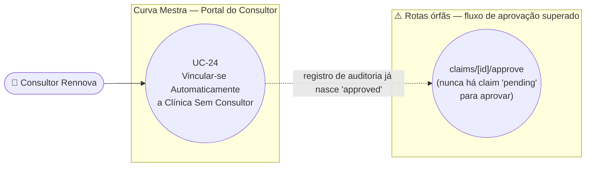

# UC-24: Vincular-se Automaticamente a uma Clínica Sem Consultor (Auto-Link)

**Projeto:** Curva Mestra
**Data de Criação:** 14/07/2026
**Autor:** Guilherme Scandelari (via uml-use-case-writer)
**Status:** Aprovado
**Módulo/Contexto:** Portal do Consultor (Vínculo com Clínicas)
**Versão:** 1.1

> Um Consultor Rennova busca uma clínica pelo CNPJ, CPF ou nome (da clínica ou do especialista) no Portal do Consultor e, se ela ainda não tiver nenhum consultor vinculado, estabelece o vínculo imediatamente com um único clique — sem aprovação de ninguém (nem da clínica, nem de um system_admin). **Achado confirmado:** existe um par de rotas de API (`api/consultants/claims/[id]/approve` e `[id]/reject`) que implementa um fluxo antigo de aprovação manual por `system_admin` — mas o próprio código-fonte confirma, em comentário, que foi substituído por este auto-link, e nenhuma tela do sistema as chama (código morto). **Atualização (v1.0.1, commit `001671b`):** a sincronização de custom claims (RN-02), antes protegida por um `try/catch` que absorvia o erro silenciosamente e sempre retornava sucesso ao cliente, passou a usar o utilitário compartilhado `src/lib/services/consultantClaimsSync.ts` — o resultado agora é reportado explicitamente via `claims_synced: boolean` no corpo da resposta. **Nota lateral:** o mesmo commit também corrigiu a rota órfã `claims/[id]/approve` (RN-05) para usar o mesmo utilitário — mas isso não altera a conclusão de que a rota continua sendo código morto (nenhuma claim `pending` é criada hoje, nenhuma tela a chama); foi uma correção de consistência/defesa em profundidade, não uma reativação do fluxo antigo. **Atualização (v1.1 — FEAT-ajustes-registro-e-busca-consultor):** a tela "Buscar Clínicas" passou a aceitar, num campo único, CNPJ, CPF ou parte do nome da clínica ou do especialista (RN-03); a busca só responde a consultor ativo (claim e documento) ou a system_admin ativo (RN-07) e só devolve clínicas ativas; e a clínica que já é do próprio consultor aparece com "Você já é o consultor desta clínica", sem botão (RN-08). Este UC é, junto com UC-25, o que descreve a tela "Buscar Clínicas".

---

## 1. Diagrama UML (Mermaid)

---

## 2. Atores

### 2.1 Ator Primário
**Consultor Rennova** — usuário Firebase Auth próprio (não pertence a nenhum `tenant_id`; `tenant_id: null` nos custom claims), com `is_consultant: true` e `consultant_id` apontando para seu documento em `consultants/{id}`. Acessa o Portal do Consultor, grupo de rotas `(consultant)`.

### 2.2 Atores Secundários / Sistemas Externos
- **Clínica (tenant)** afetada — recebe uma notificação informativa (`tenants/{tenant_id}/notifications`), mas não participa da decisão.
- **Firebase Auth** — via `adminAuth.setCustomUserClaims`, para sincronizar `authorized_tenants` no token do consultor.

---

## 3. Pré-condições
- Consultor autenticado, com `is_consultant === true` e `consultant_id` presente no token.
- **[v1.1]** Para buscar, o consultor precisa estar ativo: claim `active === true` **e** documento `consultants/{consultant_id}` com `status: "active"` (RN-07). O vínculo em si (`POST /api/consultants/claims`) continua exigindo só `is_consultant` e `consultant_id` no token (ver seção 14).
- A clínica buscada existe em `tenants`, está ativa (`active == true`; clínicas inativas nunca aparecem na busca) e **não possui** `consultant_id` preenchido.
- O consultor buscando não é já o consultor vinculado a essa clínica (checagem redundante, dado que `consultant_id` está vazio, mas existe explicitamente no código).

---

## 4. Pós-condições

### 4.1 Sucesso
- `consultants/{consultantId}.authorized_tenants` passa a incluir o `tenant_id`.
- `tenants/{tenant_id}.consultant_id`, `consultant_code` e `consultant_name` são preenchidos com os dados do consultor.
- Um documento é criado em `consultant_claims` **já com `status: 'approved'`** — funciona como registro de auditoria da ação, não como uma etapa de aprovação pendente (RN-01).
- Uma notificação informativa é criada em `tenants/{tenant_id}/notifications` (`type: 'consultant_linked'`), visível para o `clinic_admin`.
- Os custom claims do consultor (`authorized_tenants`) são atualizados para incluir o `tenant_id`, via `syncConsultantAuthorizedTenants` (etapa sequencial, fora da transação — RN-02, corrigido no commit `001671b`); o resultado (`claims_synced: boolean`) é retornado explicitamente na resposta.

### 4.2 Falha (Garantias Mínimas)
- Se a validação falhar antes do `batch` (clínica não encontrada, consultor já vinculado, claim pendente duplicada): nenhuma alteração é feita.
- Se o `batch` for commitado mas a sincronização de custom claims falhar depois: o vínculo já está gravado no Firestore (`tenants`/`consultants`), mas o token do consultor pode ficar temporariamente desatualizado até novo login ou nova tentativa (mesmo padrão de RN-03 do UC-23). **[Atualizado v1.0.1]** Diferente do comportamento anterior (falha absorvida silenciosamente, sempre `success: true` sem indicação nenhuma), a resposta agora inclui `claims_synced: false` explicitamente nesse cenário — o cliente pode, em tese, tratar esse caso de forma diferenciada (hoje a tela ainda exibe a mesma mensagem de sucesso genérica, ver RN-02 corrigido).

---

## 5. Gatilho (Trigger)
Consultor, na tela `/consultant/clinics/search`, busca uma clínica por CNPJ, CPF ou nome e clica em "Vincular Agora" num resultado que não possui consultor vinculado.

---

## 6. Fluxo Principal (Basic Flow)

1. Consultor acessa `/consultant/clinics/search` (Portal do Consultor).
2. **[Atualizado em v1.1]** Informa, no campo único "CNPJ, CPF ou nome" (placeholder "CNPJ, CPF, nome da clínica ou do especialista"), o CNPJ/CPF ou parte do nome da clínica ou do especialista, e clica no botão de busca ou pressiona Enter. Enquanto o texto não tem letra, a tela aplica a máscara de CPF/CNPJ; com letra, o texto fica como digitado.
3. **[Atualizado em v1.1]** Sistema classifica a consulta com a função pura `classifyClinicSearchQuery` (`src/lib/clinicSearch.ts`), a mesma usada pela API (RN-03): com letra → busca por nome; sem letra e com 11 ou 14 dígitos → busca por documento; nos demais casos, mostra o erro sem chamar a API (8e). Em seguida, chama `GET /api/tenants/search?q={texto}` com o Bearer token do consultor. A API verifica o acesso (RN-07; ver 8g), classifica de novo a consulta e busca só clínicas ativas: por documento, igualdade exata em `document_number`; por nome, filtro em memória sobre o nome da clínica e o nome dos especialistas (RN-03).
4. **[Atualizado em v1.1]** Sistema exibe os resultados — até 20 na busca por nome, com o aviso "Mostrando os 20 primeiros resultados. Refine a busca." quando houver mais —, cada um com o nome da clínica, o tipo/número do documento (quando houver) e o e-mail. Sem resultado, ver 8f.
5. **[Atualizado em v1.1]** Cada card mostra uma de três situações: "Vincular Agora" (clínica **sem** `consultant_id`); "Você já é o consultor desta clínica", sem botão (o `consultant_id` da clínica é o do próprio consultor, RN-08); ou "Clínica já possui o consultor **{nome}** vinculado" com o botão "Solicitar Transferência" (ver UC-25). Até a v1.0.1 este passo dizia que uma clínica com consultor não tinha botão — isso deixou de valer quando UC-25 v2.0 adicionou "Solicitar Transferência".
6. Consultor clica em "Vincular Agora".
7. Sistema chama `POST /api/consultants/claims` com `{ tenant_id }` e o Bearer token do consultor.
8. API valida o token, exige `is_consultant === true` e `consultant_id` presentes no token; busca os dados do consultor e da clínica; retorna erro se o consultor já for o vinculado a essa clínica.
9. Como `tenantData.consultant_id` está vazio, a API entra no ramo de auto-link: verifica se já existe uma claim com `status === 'pending'` para este par consultor/clínica (RN-04 — checagem hoje inatingível na prática).
10. API executa um `batch` atômico: cria o documento em `consultant_claims` já com `status: 'approved'`; adiciona `tenant_id` a `authorized_tenants` do consultor; atualiza `tenants/{tenant_id}` com `consultant_id`/`consultant_code`/`consultant_name`; cria a notificação informativa em `tenants/{tenant_id}/notifications`.
11. Após o commit do `batch` (fora dele, sequencialmente), API chama `syncConsultantAuthorizedTenants(userId, tenant_id, 'add')` (utilitário compartilhado, `src/lib/services/consultantClaimsSync.ts`) para incluir o `tenant_id` em `authorized_tenants` do consultor — a função nunca propaga exceção, sempre retorna `{ synced, error? }` (RN-02, corrigido no commit `001671b`).
12. API retorna `{ success: true, auto_linked: true, claims_synced, message: 'Vínculo estabelecido com sucesso' }`. Sistema exibe "Vínculo estabelecido com sucesso!" e marca visualmente o resultado como "Vinculado com sucesso" — **a UI ainda não diferencia visualmente o caso `claims_synced: false`** (mesma mensagem de sucesso em ambos os casos).
13. Caso de uso é concluído com sucesso.

---

## 7. Fluxos Alternativos
Nenhum identificado além do fluxo principal — a ação é única e direta (buscar → clicar → vincular).

---

## 8. Fluxos de Exceção

### 8a. Consultor já é o vinculado a esta clínica
1. API retorna 400 ("Você já é o consultor vinculado a esta clínica").
2. Sistema exibe a mensagem de erro; nada é alterado.
3. **[v1.1]** Pela tela, esse caso deixou de ser alcançável a partir da busca: o card de uma clínica do próprio consultor não tem botão (RN-08). A checagem da API continua como defesa para chamadas diretas.

### 8b. Clínica não encontrada
1. `tenant_id` recebido não corresponde a nenhum documento existente.
2. API retorna 404; sistema exibe a mensagem de erro.

### 8c. Token ausente/inválido ou usuário não é consultor
1. Sistema retorna 401 (token ausente) ou 403 (`is_consultant`/`consultant_id` ausentes no token).
2. Nenhuma alteração é feita.

### 8d. Falha ao sincronizar custom claims após o batch já commitado
1. `adminAuth.getUser`/`adminAuth.setCustomUserClaims` falha dentro de `syncConsultantAuthorizedTenants`.
2. **[CORRIGIDO em v1.0.1, commit `001671b`]** A função captura o erro internamente e retorna `{ synced: false, error }` — a API não propaga como falha da requisição, retorna sucesso ao cliente (`success: true`), mas agora com `claims_synced: false` explícito no corpo da resposta, em vez do `console.warn` isolado de antes. O usuário ainda vê "Vínculo estabelecido com sucesso!" (a UI não foi alterada para diferenciar esse caso), mas o dado de que a sincronização falhou deixa de estar disponível apenas nos logs do servidor — passa a existir no contrato de resposta da API (RN-02).

### 8e. [v1.1] Consulta de busca inválida (a partir do passo 3)
1. O texto tem letra, mas menos de 3 caracteres sem contar espaços → "Digite ao menos 3 letras do nome da clínica ou do especialista"; ou não tem letra e não tem 11 nem 14 dígitos → "Informe o CPF (11 dígitos), o CNPJ (14 dígitos) ou ao menos 3 letras do nome".
2. A tela mostra a mensagem em toast destructive, sem chamar a API. Uma chamada direta à API com a mesma consulta recebe 400 com a mesma mensagem.

### 8f. [v1.1] Nenhuma clínica encontrada (a partir do passo 4)
1. A busca não encontra clínica ativa.
2. Sistema exibe um toast e o estado vazio "Nenhuma clínica encontrada com este nome." ou "Nenhuma clínica encontrada com este documento.", conforme o tipo de busca, com a dica "Verifique os dados informados ou entre em contato com a clínica.".

### 8g. [v1.1] Acesso à busca negado (a partir do passo 3)
1. Sem token → 401 "Token não fornecido"; token inválido → 401 "Não autorizado".
2. Token válido, mas o usuário não é system_admin ativo (`is_system_admin === true` e `active === true`) nem consultor ativo (claims `is_consultant`, `consultant_id` e `active === true`, e `consultants/{id}.status === "active"`) → 403 "Acesso restrito a consultores ativos". Isso inclui o consultor suspenso com token ainda válido.
3. A tela mostra a mensagem em toast destructive; nenhum resultado é exibido.

---

## 9. Regras de Negócio Relacionadas

| ID | Regra | Justificativa |
|----|-------|----------------|
| RN-01 | O auto-link é **imediato e sem aprovação de ninguém** — nem do `clinic_admin` da clínica, nem de um `system_admin`. O documento criado em `consultant_claims` já nasce com `status: 'approved'`, servindo apenas como registro de auditoria da ação, não como uma etapa de aprovação real. A clínica só é informada **depois do fato consumado**, via notificação. | Confirmado por leitura literal do ramo "CASO 1" de `POST /api/consultants/claims`. |
| RN-02 | **[CORRIGIDO em v1.0.1, commit `001671b`]** A sincronização dos custom claims do consultor continua ocorrendo fora do `batch` atômico do Firestore (limitação de plataforma, não eliminável) — mas o `try/catch` que antes **absorvia o erro silenciosamente** (só `console.warn`, sempre retornando sucesso sem qualquer indicação) foi substituído pela chamada ao utilitário compartilhado `syncConsultantAuthorizedTenants` (`src/lib/services/consultantClaimsSync.ts`, mesmo usado pelo UC-23 e UC-26). O resultado (`claims_synced: boolean`) agora é retornado explicitamente no JSON de resposta (`auto_linked: true, claims_synced, message: '...'`) — o risco de inconsistência entre dados e claims em si não foi eliminado (mesma limitação de RN-03 do UC-23), mas deixou de ser silencioso a ponto de nem aparecer na resposta da API. | Confirmado por diff do commit `001671b` em `src/app/api/consultants/claims/route.ts` — bloco `try/catch` original substituído por `syncConsultantAuthorizedTenants`, resposta inclui `claims_synced`. |
| RN-03 | **[Reescrita em v1.1 — FEAT-ajustes-registro-e-busca-consultor; a versão anterior ("exige o documento completo, não busca por nome") deixou de valer]** A busca usa `GET /api/tenants/search?q=...`; o parâmetro antigo `?document=` continua aceito, por compatibilidade com abas abertas. A consulta é classificada por `classifyClinicSearchQuery` (mesma função na tela e na API): (1) **com pelo menos uma letra** → busca por nome; (2) **sem letra**, com 11 ou 14 dígitos → busca por documento, igualdade exata em `document_number` (só dígitos); (3) demais casos → 400. **Por nome:** o termo é normalizado (minúsculas, sem acento, espaços colapsados) e precisa ter **no mínimo 3 caracteres sem contar espaços**; a clínica casa quando **todas** as palavras do termo aparecem (como trecho) no nome da clínica **ou** no nome de um mesmo especialista. "Especialista" é o usuário `clinic_admin` ativo (`active !== false`) do tenant, pelo `full_name` (ou `displayName`); `clinic_user` não entra. Os resultados são ordenados pelo nome da clínica, **até 20**, com `truncated: true` quando há mais. O formato é o mesmo da busca por documento (`id`, `name`, `document_type`, `document_number`, `email`, `consultant_id`, `consultant_name`), inclui clínicas que já têm consultor e não diz qual especialista casou com o termo. **Só clínicas ativas** (`active == true`) aparecem, nos dois tipos de busca. A busca por nome lê com Admin SDK todos os tenants ativos e todos os `clinic_admin` a cada busca e filtra em memória (`searchActiveTenantsByName`, `src/lib/services/tenantSearchServer.ts`): sem campo novo, índice, backfill nem mudança de rule. | Decisões do usuário (FEAT, item 7 e D3 a D5): o consultor costuma conhecer o especialista ou a clínica pelo nome, e várias clínicas ainda não têm documento. O filtro em memória lê o nome atual (a clínica e o admin podem editá-lo) sem migrar dados. Validado em dev-gscandelari.web.app: busca pelo nome da clínica, pelo nome do especialista e por CNPJ. |
| RN-04 | **[Achado — checagem hoje inatingível]** O ramo de auto-link verifica se já existe uma `consultant_claims` com `status === 'pending'` para o mesmo par consultor/clínica antes de prosseguir — mas, como nenhum fluxo atual do sistema cria uma claim com esse status (o auto-link cria direto como `'approved'`, e o fluxo de transferência usa a coleção `consultant_transfer_requests`, não `consultant_claims`), essa checagem de duplicidade é hoje código efetivamente inatingível, a menos que existam registros legados de antes da migração para o fluxo atual. | Confirmado por leitura completa de `POST /api/consultants/claims` e por grep confirmando que nenhum outro caminho do código cria `consultant_claims` com `status: 'pending'`. |
| RN-05 | **[Achado crítico — mesma clareza do UC-05/UC-22, rotas órfãs confirmadas]** As rotas `POST /api/consultants/claims/[id]/approve` e `POST /api/consultants/claims/[id]/reject` implementam um fluxo antigo em que um `system_admin` aprovava/rejeitava manualmente uma claim pendente — o próprio código-fonte confirma isso em comentário: *"Apenas system_admin pode aprovar claims diretamente (o novo fluxo usa auto-link)"* e *"...o novo fluxo usa transfer requests"*. Confirmado por grep exaustivo que **nenhuma tela do sistema chama essas duas rotas**, e que, como estabelecido em RN-04, nenhum fluxo atual sequer cria uma claim `pending` para elas processarem. São código morto duplo: sem gatilho de UI e sem dado de entrada possível. **Nota (v1.0.1, commit `001671b`):** apesar de permanecer código morto (conclusão acima inalterada — sem gatilho de UI, sem dado de entrada), a rota `claims/[id]/approve` foi encontrada, na mesma varredura que corrigiu RN-02 (UC-23/UC-24/UC-26), com o mesmo bug de sincronização de claims sem `try/catch` protegido (chamada direta a `adminAuth.getUser`/`setCustomUserClaims`, capaz de derrubar a resposta com 500 **se** algum dia voltasse a ser alcançável). Foi corrigida por consistência/defesa em profundidade — passou a usar `syncConsultantAuthorizedTenants` e a retornar `claims_synced: boolean` — mas isso não reativa nem torna o fluxo alcançável; é relevante apenas caso a decisão pendente do item 1 da Seção 14 seja, no futuro, reconectar essa rota. `claims/[id]/reject` (a rota irmã) **não** foi tocada por este commit e permanece com o comportamento original (sem chamada a claims, já que rejeitar não sincroniza `authorized_tenants`). | Confirmado por leitura completa das duas rotas e grep de `consultants/claims` em `src/app`. Correção adicional confirmada por diff do commit `001671b` em `src/app/api/consultants/claims/[id]/approve/route.ts`. |
| RN-06 | **[Achado adicional de regra Firestore]** A regra do Firestore para `consultant_claims` permite que o `clinic_admin` do tenant faça `read, update` diretamente nos documentos de claim do seu tenant (`belongsToTenant(resource.data.tenant_id) && hasRole('clinic_admin')`) — ou seja, mesmo que as rotas de API de aprovação/rejeição (RN-05) estejam mortas, um `clinic_admin` poderia, em tese, escrever diretamente no Firestore para alterar o `status` de uma claim, sem qualquer tela ou validação de negócio server-side. Como nenhuma claim `pending` chega a existir hoje (RN-04), esse é um risco teórico, não ativo. | Confirmado por leitura de `firestore.rules`, `match /consultant_claims/{claimId}`. |
| RN-07 | **[Nova em v1.1 — RF-14 da FEAT]** A busca só responde a **consultor ativo** — claims `is_consultant`, `consultant_id` e `active === true` **e** documento `consultants/{consultant_id}` com `status: "active"` (`checkActiveConsultant`, a mesma checagem de UC-56/RN-07) — ou a **system_admin ativo** (`is_system_admin === true` e `active === true`). Os demais recebem 403 "Acesso restrito a consultores ativos" (8g). | Antes, a rota aceitava qualquer token com `is_consultant` ou `is_system_admin`, sem olhar `active` nem o status do consultor: um consultor suspenso com token ainda válido conseguia buscar. |
| RN-08 | **[Nova em v1.1 — decisão D9-A da FEAT]** Quando a clínica encontrada já tem como consultor o próprio consultor logado (`tenant.consultant_id` igual ao claim `consultant_id`, comparação feita só no client), o card mostra "Você já é o consultor desta clínica", **sem botão**. | Antes, o card mostrava "Solicitar Transferência" e a API respondia 400 "Você já é o consultor vinculado a esta clínica". A busca por nome deixa esse caso mais frequente. |

---

## 10. Requisitos Especiais / Não Funcionais

| ID | Descrição | Categoria |
|----|-----------|-----------|
| RNF-01 | Diferente das rotas administrativas de UC-21/UC-23, a falha de sincronização de custom claims aqui era **absorvida silenciosamente** (RN-02) — não era reportada nem ao usuário nem de forma diferenciada nos logs (mesmo nível de severidade que um aviso comum). **[Atualizado v1.0.1]** Desde o commit `001671b`, o resultado (`claims_synced`) passa a ser reportado no corpo da resposta — a observabilidade melhora no contrato da API, mas a UI ainda não usa esse dado para diferenciar a mensagem exibida ao usuário. | Observabilidade |
| RNF-02 | A validação de Bearer token e de claims (`is_consultant`/`consultant_id`) segue o mesmo padrão correto encontrado em outras rotas administrativas do sistema. | Segurança |
| RNF-03 | **[Nova em v1.1]** `GET /api/tenants/search` responde com `Cache-Control: no-store` e não registra em log o termo buscado; o `console.error` registra só o erro. A busca roda só no servidor (Admin SDK): as rules de `tenants` e `users` não foram abertas para o consultor. | Privacidade / Segurança |
| RNF-04 | **[Nova em v1.1]** Custo da busca por nome: uma leitura por tenant ativo e por `clinic_admin` a cada busca. Na verificação de produção de 16/10/2026 (FEAT, V2), isso dava cerca de 8 documentos por busca (4 tenants e 4 `clinic_admin` ativos). A abordagem deve ser revista acima de ~1.000 documentos por busca (seção 14). | Performance |

---

## 11. Frequência de Uso
Ocasional a frequente — depende do ritmo de expansão da carteira de clínicas de cada consultor; presumivelmente mais comum no onboarding inicial de um novo consultor.

---

## 12. Casos de Uso Relacionados
- **UC-25 (Solicitar Transferência de Clínica Já Vinculada)** — mesma tela, mesma API (`POST /api/consultants/claims`), mas ramo "CASO 2" (clínica já tem consultor); ver achado crítico sobre ausência de gatilho de UI documentado lá.
- **UC-23 (Vincular/Alterar/Remover Consultor de uma Clínica via Painel Admin)** — mecanismo equivalente do lado do `system_admin`; desde o commit `001671b`, ambos os UCs (e o UC-26) compartilham o mesmo utilitário de sincronização de claims (`src/lib/services/consultantClaimsSync.ts`).
- **UC-26 (Aprovar Pedido de Transferência de Clínica)** — terceira rota que passou a usar o mesmo utilitário compartilhado (commit `001671b`).
- **UC-21/UC-22** — tela `admin/tenants/[id]/page.tsx`, onde `tenant.consultant_id` também pode ser gerenciado.
- **[v1.1] UC-01 / UC-02 / UC-56** — o CPF/CNPJ coletado do especialista em UC-01 (v2.4) vai para o tenant na aprovação e torna a clínica encontrável pela busca por documento. Clínicas criadas antes disso, sem documento, são encontradas pela busca por nome.
- **[v1.1] UC-56** — a guarda de consultor ativo da busca (RN-07) é a mesma checagem usada nas rotas de UC-56 (`checkActiveConsultant` / `verifyActiveConsultant`).
- **UC-48 (Consultar Clínicas Vinculadas e Estoque)** — o estado vazio de "Minhas Clínicas" leva a esta tela pelo botão "Buscar Clínicas".

---

## 13. Referências
- `src/app/(consultant)/consultant/clinics/search/page.tsx`
- `src/app/api/consultants/claims/route.ts` (ramo "CASO 1"; alterado pelo commit `001671b` — sincronização de claims via `syncConsultantAuthorizedTenants`, RN-02)
- `src/app/api/consultants/claims/[id]/approve/route.ts` (órfão — RN-05; também alterado pelo commit `001671b`, mesma correção defensiva)
- `src/app/api/consultants/claims/[id]/reject/route.ts` (órfão — RN-05; não alterado)
- `src/app/api/tenants/search/route.ts` (desde a v1.1: `?q=` ou `?document=`, guarda de consultor/system_admin ativo, `truncated`)
- `src/lib/clinicSearch.ts` (`classifyClinicSearchQuery`, `normalizeSearchText`, `filterTenantsByName`, `MIN_NAME_QUERY_LENGTH = 3`, `MAX_NAME_RESULTS = 20`)
- `src/lib/services/tenantSearchServer.ts` (`searchActiveTenantsByDocument`, `searchActiveTenantsByName`)
- `src/lib/services/accessRequestRouteHelpers.ts` (`checkActiveConsultant`, RN-07)
- `src/__tests__/clinicSearch.test.ts` e `src/__tests__/tenantSearchRoute.test.ts`
- `ONLY_FOR_DEVS/TASK_COMPLETED/FEAT-ajustes-registro-e-busca-consultor.md` (v1.2)
- `src/lib/services/consultantClaimsSync.ts` (utilitário compartilhado de sincronização de claims — RN-02, commit `001671b`)
- `src/types/index.ts` (`Consultant`, `CustomClaims`)
- `firestore.rules` (`consultants/{consultantId}`, `consultant_claims/{claimId}`)

---

## 14. Perguntas em Aberto / Decisões Pendentes

1. **[RN-05]** As rotas `claims/[id]/approve` e `claims/[id]/reject` são código morto duplamente confirmado — decisão de produto pendente: remover, ou mantê-las como estão (sem risco ativo, já que nunca são alcançadas). **Nota v1.0.1:** `claims/[id]/approve` recebeu, ainda assim, a mesma correção de sincronização de claims que UC-23/UC-24/UC-26 (commit `001671b`) — puramente defensivo, não altera esta pendência nem a conclusão de que a rota é inalcançável hoje.
2. ~~**[RN-02]** A falha silenciosa na sincronização de custom claims pode causar um estado onde o Firestore já reflete o vínculo, mas o token do consultor (até novo login) ainda não enxerga a clínica — vale avaliar se deveria haver alguma notificação/retry.~~ **[PARCIALMENTE RESOLVIDO em v1.0.1, commit `001671b`]** A falha deixou de ser silenciosa — `claims_synced: false` agora é reportado na resposta da API. **Ainda em aberto:** a UI não usa esse campo (mensagem de sucesso é a mesma independente de `claims_synced`), e não há retry/notificação automática quando `synced: false`.
3. **[RN-06]** Risco teórico de escrita direta por `clinic_admin` na coleção `consultant_claims` via regra Firestore permissiva — hoje não explorável na prática (RN-04), mas vale revisão futura da regra.
4. **[Novo, v1.0.1]** Sinalizar ao `uc-issues-tracker`: a correção do commit `001671b` tocou uma rota (`claims/[id]/approve`) que este UC documenta como código morto (RN-05) — vale revisão cruzada para confirmar que nenhum outro UC assume incorretamente que essa rota está ativa ou reconectada à UI.
5. **[v1.1 — decisão do usuário: manter assim por ora]** Na busca por nome, uma palavra de uma letra casa com quase qualquer nome, porque o casamento é por trecho e o mínimo de 3 caracteres vale para o termo inteiro, não para cada palavra. Exemplo: "a b c" passa no mínimo e casa com quase todas as clínicas (o resultado é cortado em 20). O usuário decidiu manter esse comportamento por ora.
6. **[v1.1 — rever com o crescimento]** A busca por nome lê todos os tenants ativos e todos os `clinic_admin` a cada busca e filtra em memória (RNF-04). O custo deve ser revisto quando a soma passar de ~1.000 documentos por busca (a FEAT cita, como alternativa, um campo de busca normalizado com índice — opção D4-B, descartada por ora).
7. **[v1.1 — fora do escopo da FEAT, achado F6]** `POST /api/consultants/claims` (o vínculo) ainda não confere `consultants/{id}.status`: um consultor suspenso com token válido não consegue mais buscar (RN-07), mas a rota de vínculo não o bloqueia se for chamada diretamente.
8. **[v1.1 — fora do escopo da FEAT, achado F7]** A busca por documento só lê `document_number`; um tenant antigo que tenha só o campo legado `cnpj` não é encontrado por documento (a busca por nome o encontra).

---

## 15. Histórico de Versões

| Versão | Data | Autor | O que mudou |
|--------|------|-------|--------------|
| 1.0 | 14/07/2026 | Guilherme Scandelari | Versão inicial, investigada do zero. Confirmado que o auto-link é imediato e sem aprovação de ninguém (RN-01); identificadas as rotas órfãs `claims/[id]/approve`/`reject`, confirmadas como código morto duplo tanto por ausência de chamada na UI quanto por ausência de dado de entrada (`status: 'pending'`) desde a migração para este fluxo (RN-04, RN-05); e uma falha silenciosa na sincronização de custom claims não presente nas rotas administrativas equivalentes (RN-02). Primeiro de 4 UCs do módulo "Consultor — vínculo com clínicas" (UC-24 a UC-27). |
| 1.0.1 | 24/07/2026 | Guilherme Scandelari | Correção pontual (commit `001671b`): RN-02 marcada como corrigida — a sincronização de custom claims em `POST /api/consultants/claims` (CASO 1, auto-link) passou a usar o utilitário compartilhado `src/lib/services/consultantClaimsSync.ts`, com `try/catch` interno que nunca propaga exceção; resposta passa a incluir `claims_synced: boolean` no lugar do `console.warn` silencioso anterior. Nota adicional: a mesma correção também tocou a rota órfã `claims/[id]/approve` (RN-05), sem alterar sua condição de código morto — documentado como nota lateral e sinalizado para o `uc-issues-tracker`. Seções 4.1, 4.2, 6 (passos 11-12), 8d, 9 (RN-02, RN-05), 10 (RNF-01), 12, 13 e 14 atualizadas. |
| 1.1 | 17/10/2026 | Guilherme Scandelari (via uml-use-case-writer) | **Atualização as-is — FEAT-ajustes-registro-e-busca-consultor** (`ONLY_FOR_DEVS/TASK_COMPLETED/FEAT-ajustes-registro-e-busca-consultor.md`, v1.2; PR #402, feature → `gscandelari_setup`, merge `3da2b79`; PR #403, `gscandelari_setup` → `develop`). (1) RN-03 reescrita (a antiga deixou de valer): busca por CNPJ, CPF ou nome da clínica ou do especialista (`clinic_admin` ativo), campo único, mínimo de 3 caracteres e até 20 resultados com aviso de corte, só clínicas ativas, `?document=` aceito por compatibilidade. (2) Nova RN-07: busca só para consultor ativo (claim e documento) ou system_admin ativo. (3) Nova RN-08: card "Você já é o consultor desta clínica", sem botão. (4) Novos fluxos de exceção 8e (consulta inválida), 8f (nenhum resultado) e 8g (acesso negado); 8a anotado como inalcançável pela tela. (5) Novas RNF-03 (`no-store`, sem log do termo) e RNF-04 (custo da busca em memória). (6) Seção 14: palavras de uma letra (decisão do usuário: manter por ora), revisão de custo acima de ~1.000 documentos, achados F6 e F7. Corrigido também o passo 5, que ainda dizia que clínica com consultor não tinha botão (desatualizado desde UC-25 v2.0). Resumo, Pré-condições, Gatilho, Fluxo Principal (passos 2-5), seções 12 e 13 atualizados. Diagrama sem mudança. |
