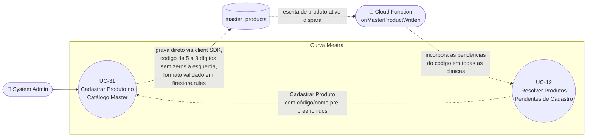

# UC-31: Cadastrar Produto no Catálogo Master

**Projeto:** Curva Mestra
**Data de Criação:** 15/07/2026
**Autor:** Guilherme Scandelari (via uml-use-case-writer)
**Status:** Aprovado
**Módulo/Contexto:** Administração do Sistema (Catálogo de Produtos Master — Rennova)
**Versão:** 1.2

> Um System Admin cadastra um novo produto no catálogo master Rennova (código, nome, categoria opcional, e se é fragmentável) em `/admin/products/new`. Não há rota `/api/*` intermediando a gravação: o formulário grava direto no Firestore via client SDK (`addDoc`), e a regra de segurança de `master_products` valida quem escreve (só `system_admin`) e o formato de `code` e `name` (RN-02). **[v1.1, BUGFIX-identidade-e-duplicidade-nfe, PR #393]** O código passa a ter de 1 a 7 dígitos, não pode ser só zeros e é gravado e buscado sem zeros à esquerda (rule `^[1-9][0-9]{0,6}$`), na mesma forma do `cProd` normalizado da NF-e. Como o produto nasce ativo, o cadastro dispara a Cloud Function `onMasterProductWritten`, que incorpora ao estoque das clínicas as linhas de NF-e pendentes com esse código (UC-12). **[v1.2, FEAT-pendencias-nfe-fora-padrao-manual-recusa-checagem, PRs #396/#397]** O código passa a ter de **5 a 8 dígitos**, sem zeros à esquerda (rule `^[1-9][0-9]{4,7}$`; campo com até 8 caracteres), no padrão dos códigos Rennova. O prefill vindo da fila de pendências só aceita código nesse padrão, sem truncar. Fecha `UC-31-Q3`.

---

## 1. Diagrama UML (Mermaid)

---

## 2. Atores

### 2.1 Ator Primário
**System Admin**, com a tela restrita por `ProtectedRoute allowedRoles: ['system_admin']` (`src/app/(admin)/layout.tsx`).

### 2.2 Atores Secundários / Sistemas Externos
- Não há API route nem e-mail. A barreira de autorização e de formato é a regra de segurança do Firestore (RN-02).
- **[v1.1] Cloud Function `onMasterProductWritten`** (`onDocumentWritten('master_products/{productId}')`, região `southamerica-east1`): reage à criação do produto ativo e incorpora as pendências de NF-e com o mesmo código, em todas as clínicas, notificando cada uma (UC-12, UC-44). Roda depois da gravação e não interfere no resultado deste UC.

---

## 3. Pré-condições
- System Admin autenticado, com `is_system_admin === true` e `active === true`.
- Não existe produto em `master_products` com o mesmo código normalizado (sem zeros à esquerda).

---

## 4. Pós-condições

### 4.1 Sucesso
- Um documento é criado em `master_products` com: `code` (**[v1.1]** sem zeros à esquerda), `name` (maiúsculas), `active: true` (padrão; a tela não oferece criar inativo), `fragmentavel`, `category` (se selecionada), `unidades_por_embalagem` (só se `fragmentavel === true`), `created_at`/`updated_at` (`serverTimestamp()`).
- System Admin é redirecionado para `/admin/products`.
- **[v1.1]** Em seguida, a Cloud Function `onMasterProductWritten` incorpora ao inventário as pendências abertas com esse código (de todas as clínicas), marca-as como `resolvida`, atualiza os registros de importação e notifica cada clínica (UC-12, RN-07). Se não houver pendência, nada acontece.

### 4.2 Falha (Garantias Mínimas)
- Se uma validação do client falhar (código, nome, unidades) ou o código já existir: nenhum documento é criado; o erro aparece no formulário.
- Se o payload não satisfizer a rule (`code` fora de `^[1-9][0-9]{4,7}$` — **[v1.2]** antes, `^[1-9][0-9]{0,6}$` —, ou `name` vazio/ausente) — só alcançável contornando a UI — o Firestore rejeita a escrita (`PERMISSION_DENIED`).
- Não há escrita parcial: é uma única operação `addDoc`. Uma falha na incorporação de pendências (depois da criação) não desfaz o cadastro; as pendências continuam abertas e podem ser reprocessadas (UC-12, "Reprocessar").

---

## 5. Gatilho (Trigger)
- **Direto:** System Admin acessa `/admin/products` e clica em "Novo Produto".
- **Indireto (UC-12):** System Admin clica em "Cadastrar Produto" numa linha da fila `/admin/pending-products`; a tela abre com código e nome pré-preenchidos (RN-04).

---

## 6. Fluxo Principal (Basic Flow)

1. System Admin acessa `/admin/products/new`.
2. Preenche "Código do Produto": o input aceita só dígitos, **[v1.2]** até 8 caracteres (`formatCodeInput` → `formatProductCode`, `maxLength={8}`), com a dica "5 a 8 dígitos; zeros à esquerda são removidos".
3. Preenche "Nome do Produto"; uma pré-visualização mostra o nome em maiúsculas (`normalizeProductName`).
4. Opcionalmente seleciona uma "Categoria" (uma das 7 fixas: Preenchedores, Bioestimuladores, Fios de PDO, Toxina, Cannulas, Care Home, Care Professional).
5. Opcionalmente ativa "Produto Fragmentável", que exige "Unidades por Embalagem" (mínimo 2); ao desativar, o campo é limpo.
6. System Admin clica em "Criar Produto".
7. Sistema valida no client: código não vazio; **[v1.2]** código só com dígitos que, sem os zeros à esquerda, tenha de 5 a 8 dígitos (`validateProductCode`, que usa `isCatalogProductCode`); nome não vazio; se fragmentável, unidades ≥ 2.
8. Sistema chama `createMasterProduct({ code, name, category, fragmentavel, unidades_por_embalagem })` (sem `active`; o serviço aplica `true`).
9. **[v1.1]** `createMasterProduct` normaliza o código com `normalizeLeadingZeros` e verifica duplicidade com `getMasterProductByCode` (que também normaliza o argumento). Se já existir, lança "Já existe um produto com o código {código normalizado}" e nada é gravado (RN-01).
10. `createMasterProduct` monta o objeto (`code` normalizado, `name.trim().toUpperCase()`, `active: true`, `fragmentavel`, `category` se definida, `unidades_por_embalagem` se fragmentável, timestamps) e executa `addDoc(collection(db, 'master_products'), productData)`.
11. A regra de `master_products` (`allow create`) revalida que `code` casa com **[v1.2]** `^[1-9][0-9]{4,7}$` (função `isCatalogCode`) e que `name` é string não vazia (RN-02); transparente no caminho feliz.
12. Sistema redireciona para `/admin/products`.
13. **[v1.1]** A escrita dispara `onMasterProductWritten`. Como o produto foi criado ativo, a função incorpora as pendências abertas com o código (UC-12, passos 8-11).
14. Caso de uso é concluído com sucesso.

---

## 7. Fluxos Alternativos

### 7a. Acesso via fila de pendências (a partir do passo 1, ver UC-12)
1. System Admin chega pela ação "Cadastrar Produto" da fila `/admin/pending-products`.
2. **[ATUALIZADO em v1.2]** A tela abre com "Nome" pré-preenchido a partir da URL (`?codigo=&nome=`, desde o commit `262584f`). O "Código" só é pré-preenchido se, sem os zeros à esquerda, estiver no padrão do catálogo (5 a 8 dígitos); nesse caso, entra já sem os zeros (ex.: `?codigo=0309961` → `309961`). Um código fora do padrão (ex.: `A12`, `123456789`) deixa o campo vazio, sem truncar nem tirar letras (RN-04). Na prática, as pendências fora do padrão nem têm "Cadastrar Produto" na fila (UC-12).
3. Segue o fluxo principal a partir do passo 2.
4. **[v1.1]** Ao concluir, o admin **não** precisa voltar à fila para resolver a pendência: a incorporação é automática (passo 13). A pendência some da fila no próximo carregamento. O admin não é redirecionado de volta à fila.

---

## 8. Fluxos de Exceção

### 8a. Código inválido
1. **[ATUALIZADO em v1.2]** Código vazio, com caractere que não seja dígito ou que, sem os zeros à esquerda, tenha menos de 5 ou mais de 8 dígitos (ex.: `1234`, `0000`).
2. Sistema exibe "Código do produto é obrigatório" (vazio) ou "Código inválido. Use de 5 a 8 dígitos (zeros à esquerda não contam)."; nenhuma chamada ao Firestore é feita.

### 8b. Nome vazio
1. Campo "Nome do Produto" vazio ou só espaços.
2. Sistema exibe "Nome do produto é obrigatório".

### 8c. Produto fragmentável sem unidades válidas
1. `fragmentavel === true` e unidades vazias ou menores que 2.
2. Sistema exibe "Produto fragmentável requer unidades por embalagem (mínimo 2)".

### 8d. Código duplicado
1. **[ATUALIZADO em v1.1]** Já existe produto com o mesmo código **normalizado** (ex.: digitar `0123456` quando já existe `123456`).
2. `createMasterProduct` lança "Já existe um produto com o código {código}"; nenhum documento é criado.

### 8e. Falha genérica do Firestore
1. `addDoc` falha (rede, token expirado, formato rejeitado pela rule — RN-02).
2. Sistema exibe "Erro ao criar produto" (ou a mensagem do erro); nenhum documento é criado.

---

## 9. Regras de Negócio Relacionadas

| ID | Regra | Justificativa |
|----|-------|----------------|
| RN-01 | A checagem de duplicidade de código (`getMasterProductByCode` antes do `addDoc`) não é atômica: duas criações simultâneas com o mesmo código poderiam passar ambas. **[v1.1]** A comparação passou a usar o código normalizado (sem zeros à esquerda), então `0123456` e `123456` são o mesmo código. | Confirmado em `createMasterProduct`, sem transação. |
| RN-02 | **[CORRIGIDO no commit `7c3cbb2`; ATUALIZADO em v1.1]** A rule de `master_products` é dividida em `allow create`/`allow update`/`allow delete`, todas só para `isSystemAdmin()`. `create` e `update` validam `name` como string não vazia e o código. **[ATUALIZADO em v1.2]** O código precisa casar com `^[1-9][0-9]{4,7}$` (função `isCatalogCode`) — de 5 a 8 dígitos, sem zero à esquerda (v1.1: `^[1-9][0-9]{0,6}$`, 1 a 7 dígitos; antes de v1.1, `^[0-9]{7}$`). No `update`, o formato do código só é exigido quando o código **muda** (`request.resource.data.get('code', null) == resource.data.get('code', null)` ou código no padrão), para que um produto legado fora do padrão continue editável e desativável (UC-32); o `name`, se presente, continua validado. Antes de v1.2, como `request.resource.data` é o documento inteiro, qualquer update revalidava o código atual (achado F1 do spec). **Lacuna residual:** `unidades_por_embalagem` (obrigatório e ≥ 2 quando fragmentável) continua validado só no client. | Confirmado em `firestore.rules` (`isCatalogCode`, l. 65-67; `match /master_products/{productId}`, l. 303-324 em HEAD `8b6f0ba`) e nos testes de rules (**[v1.2]** `'12345'`, `'309960'`, `'3076528'` e `'12345678'` aceitos; `'1234'`, `'123456789'`, `'0123456'`, `'A1234'`, `'0'` e `''` recusados). |
| RN-03 | Produto sempre é criado com `active: true`; a tela não oferece criar inativo. **[v1.1]** Por isso todo cadastro dispara a incorporação de pendências do código (RN-07). | Confirmado em `new/page.tsx` e `createMasterProduct`. |
| RN-04 | **[CORRIGIDO — leitura as-is em v1.1; ATUALIZADA em v1.2]** O texto até v1.0.1 dizia que "Cadastrar Produto" (UC-12) não passava prefill; isso deixou de ser verdade no commit `262584f` (PR #355): a tela lê `codigo` e `nome` da URL (`useSearchParams`) e pré-preenche os campos (UC-12 RN-01). **[v1.2]** O código só é pré-preenchido se `isCatalogProductCode` aceitar o valor sem os zeros à esquerda; senão, o campo fica vazio, sem truncar. O nome é sempre pré-preenchido. | Confirmado em `admin/products/new/page.tsx` (l. 103-113) e `pending-products/page.tsx`. |
| RN-05 | `master_products` é uma coleção **global**, sem `tenant_id`: leitura para qualquer usuário autenticado e ativo (`allow read: if isAuthenticated()`), escrita só para `system_admin`. É a exceção deliberada ao isolamento por tenant. | Confirmado em `firestore.rules`. |
| RN-06 | **[NOVA em v1.1 — BUGFIX-identidade-e-duplicidade-nfe, STEP 8]** O código é gravado e buscado **sem zeros à esquerda** (`normalizeLeadingZeros` em `createMasterProduct`, `updateMasterProduct` e `getMasterProductByCode`), na mesma forma do `cProd` normalizado da NF-e (UC-10 RN-17). Sem isso, um código de catálogo com zero nunca casaria com a linha da NF. **[ATUALIZADO em v1.2]** O formulário aceita até 8 dígitos (`formatProductCode`) e `validateProductCode` aceita só dígitos que, sem os zeros à esquerda, tenham de 5 a 8 dígitos (antes de v1.2, de 1 a 7). Exemplos: `00012345` → gravado `12345`; `1234` → recusado; `12345678` → aceito. | Decisão do usuário (spec Seção 4.1, item 9; FEAT-pendencias RN-01, RF-01). O usuário confirmou que produção não tinha códigos com zero à esquerda (spec v1.2, pendência 2). |
| RN-07 | **[NOVA em v1.1]** Criar um produto (sempre ativo) dispara a Cloud Function `onMasterProductWritten`, que lança no inventário de **todas** as clínicas as linhas de NF-e pendentes com o mesmo código, marca as pendências como `resolvida`, atualiza os registros de importação e notifica cada clínica (`nf_pending_resolved`). O trigger cobre qualquer caminho de escrita no catálogo (esta tela, UC-32 e os scripts `scripts/import-master-products*.js`). | Confirmado em `functions/src/onMasterProductWritten.ts` e `shouldResolvePendingForProduct`. Detalhes em UC-12 RN-07 a RN-10. |
| RN-08 | **[NOVA em v1.2 — FEAT-pendencias-nfe-fora-padrao-manual-recusa-checagem, PR #396]** O formato do código fica centralizado em `CATALOG_CODE_PATTERN` / `isCatalogProductCode` (`src/types/masterProduct.ts`), espelhado literalmente na rule (`isCatalogCode`). O mesmo padrão define o que é "código fora do padrão" na importação XML (UC-10 RN-21: pendência que nunca é incorporada e só sai da fila por recusa) e o código aceito para um produto Rennova informado à mão no lançamento manual (UC-11 RN-17). Verificação do usuário em 15/10/2026: dev com 73 produtos (72 de 7 dígitos e 1 de 6) e produção com 70 (69 de 7 e 1 de 6), nenhum fora de `^[1-9][0-9]{4,7}$`. Os scripts `scripts/import-master-products*.js` gravam com Admin SDK e não passam pela rule. | Decisão do usuário (RNF-05 do spec). Confirmado em `src/types/masterProduct.ts` e `firestore.rules`. Validado em `dev-gscandelari.web.app` em 16/10/2026. |

---

## 10. Requisitos Especiais / Não Funcionais

| ID | Descrição | Categoria |
|----|-----------|-----------|
| RNF-01 | **[Mitigado no commit `7c3cbb2`]** `code` e `name` são validados em `firestore.rules`; `unidades_por_embalagem` continua só no client, e o módulo não usa API route com Admin SDK. | Confiabilidade |
| RNF-02 | A leitura ampla e sem isolamento por tenant (RN-05) é intencional e deve ser preservada. | Multi-tenant |
| RNF-03 | **[NOVO em v1.1]** A incorporação de pendências é assíncrona (trigger): a tela não espera por ela nem mostra seu resultado. O efeito aparece em segundos no inventário e nas notificações das clínicas, e na fila de UC-12 ao recarregar. | Usabilidade / Confiabilidade |

---

## 11. Frequência de Uso
Ocasional: quando a Rennova lança um item novo, ou quando surge uma pendência (UC-12) por um código fora do catálogo na importação de NF-e (UC-10).

---

## 12. Casos de Uso Relacionados
- **UC-12 (Resolver Produtos Pendentes de Cadastro):** "Cadastrar Produto" leva a este UC com prefill (RN-04); o cadastro dispara a incorporação automática das pendências (RN-07).
- **UC-10 (Importar NF-e via Upload de XML):** consome o catálogo por código normalizado e só aceita produto ativo; linhas sem produto ativo viram pendência.
- **UC-11 (Inserir Nota Fiscal Manualmente):** consome o catálogo (produtos ativos) no ramo Rennova.
- **UC-32 (Editar, Ativar e Desativar Produto no Catálogo Master):** ciclo de vida do produto; reativação e troca de código de produto ativo também disparam a incorporação.
- **UC-44 (Consultar e Gerenciar Notificações Recebidas):** recebe a notificação `nf_pending_resolved` gerada pela incorporação.

---

## 13. Referências
- `src/app/(admin)/admin/products/new/page.tsx` (**[v1.2]** validação "Use de 5 a 8 dígitos (zeros à esquerda não contam).", `maxLength={8}`, prefill por `useSearchParams` só com código no padrão)
- `src/lib/services/masterProductService.ts` (`createMasterProduct`, `getMasterProductByCode`, ambos com `normalizeLeadingZeros`)
- `src/lib/nfIdentity.ts` (`normalizeLeadingZeros`)
- `src/types/masterProduct.ts` (**[v1.2]** `CATALOG_CODE_PATTERN`, `isCatalogProductCode`, `validateProductCode` 5–8 dígitos, `formatProductCode` até 8; `normalizeProductName`, `MASTER_PRODUCT_CATEGORIES`)
- `src/app/(admin)/layout.tsx` (`ProtectedRoute allowedRoles`)
- `firestore.rules` (**[v1.2]** `isCatalogCode`, `^[1-9][0-9]{4,7}$`; `match /master_products/{productId}`)
- `functions/src/onMasterProductWritten.ts`, `functions/src/pendingResolution.ts` (incorporação, **[v1.1]**)
- Commit `7c3cbb2` (validação de formato em `firestore.rules`, RN-02); commit `262584f` (prefill, RN-04); PR #393 / `ONLY_FOR_DEVS/TASK_COMPLETED/BUGFIX-identidade-e-duplicidade-nfe.md` v1.2 (STEP 8 e STEP 9)
- **[v1.2]** `ONLY_FOR_DEVS/TASK_COMPLETED/FEAT-pendencias-nfe-fora-padrao-manual-recusa-checagem.md` (v1.3, STEP 1); PR #396 (merge `8b6f0ba`) e PR #397

---

## 14. Perguntas em Aberto / Decisões Pendentes

1. **[RESOLVIDO PARCIALMENTE no commit `7c3cbb2` — UC-31-RN-02]** A rule valida `code` e `name`. Decisão residual pendente: validar também `unidades_por_embalagem` na rule, ou introduzir uma rota `/api/products/*`.
2. **[RN-01]** Janela de corrida teórica na checagem de duplicidade de código (risco baixo).
3. **[RESOLVIDO em v1.2 — PR #396; `UC-31-Q3`]** O formato do catálogo passou a 5 a 8 dígitos (RN-02, RN-06, RN-08). Um `cProd` fora desse padrão vira pendência "fora do padrão" na importação, numa seção própria da fila e só com "Recusar" (UC-10 RN-21, UC-12 RN-13), e o prefill de "Cadastrar Produto" não trunca mais (RN-04). O fechamento no mapa fica com o `uc-issues-tracker`.

---

## 15. Histórico de Versões

| Versão | Data | Autor | O que mudou |
|--------|------|-------|--------------|
| 1.0 | 15/07/2026 | Guilherme Scandelari | Versão inicial, investigada do zero a partir de `masterProductService.ts`, `admin/products/new/page.tsx` e `firestore.rules`. Confirmado que não há rota `/api/products/*` nem Cloud Function — toda a operação é client SDK direto, com validação de formato exclusivamente no client (RN-02, achado arquitetural). Confirmada a ausência de isolamento por tenant no catálogo master, deliberada (RN-05). Primeiro UC do módulo "Admin — Catálogo de Produtos Master". |
| 1.0.1 | 26/07/2026 | Guilherme Scandelari (via uml-use-case-writer) | Correção pontual (UC-31-RN-02): a regra de segurança de `master_products` em `firestore.rules` foi dividida em `allow create`/`allow update`/`allow delete` (antes, um único `allow write: if isSystemAdmin()`), com `create`/`update` validando `code.matches('^[0-9]{7}$')` e `name` como string não vazia — em `update`, apenas para os campos efetivamente enviados no payload. Corrigido no commit `7c3cbb2`. Registrada a lacuna residual: `unidades_por_embalagem` continua validado apenas no client. Atualizados resumo do cabeçalho, diagrama (Seção 1), Pós-condição 4.2, Fluxo Principal (novo passo 11), Fluxo de Exceção 8e, RN-02 (marcado `[CORRIGIDO]`), RNF-01, Casos de Uso Relacionados (Seção 12), Referências (Seção 13) e item 1 da Seção 14 (marcado `[RESOLVIDO PARCIALMENTE]`). |
| 1.1 | 15/10/2026 | Guilherme Scandelari (via uml-use-case-writer) | **Atualização as-is: código do catálogo sem zeros à esquerda e incorporação automática de pendências (`TASK_COMPLETED/BUGFIX-identidade-e-duplicidade-nfe.md` v1.2, STEPs 8 e 9; PR #393, merge `2bc543f`; validado em `dev-gscandelari.web.app` em 15/10/2026).** Código com 1 a 7 dígitos, não só zeros, gravado e buscado sem zeros à esquerda; rule `^[1-9][0-9]{0,6}$` (antes `^[0-9]{7}$`); criar o produto (sempre ativo) dispara `onMasterProductWritten`, que incorpora as pendências do código em todas as clínicas. RN-01, RN-02 e RN-03 atualizadas; novas RN-06 (normalização do código) e RN-07 (incorporação); novo RNF-03. **Correção as-is fora do bugfix:** RN-04, o gatilho indireto e o Fluxo Alternativo 7a ainda diziam que "Cadastrar Produto" não levava prefill e que era preciso "Marcar Resolvido" depois; o prefill existe desde o commit `262584f` (PR #355) e "Marcar Resolvido" foi removido no PR #393. Diagrama com a Cloud Function; Seções 2, 4, 5, 6 (passos 2, 7, 9-11 e novo 13), 8a, 8d, 12, 13 e 14 (novo item 3, observação a confirmar) atualizadas. |
| 1.2 | 16/10/2026 | Guilherme Scandelari (via uml-use-case-writer) | **Atualização as-is: código do catálogo com 5 a 8 dígitos (`TASK_COMPLETED/FEAT-pendencias-nfe-fora-padrao-manual-recusa-checagem.md` v1.3, STEP 1; PR #396, merge `8b6f0ba` em `gscandelari_setup`, e PR #397; validado em `dev-gscandelari.web.app` em 16/10/2026).** Código de 5 a 8 dígitos sem zeros à esquerda (rule `^[1-9][0-9]{4,7}$`, antes `^[1-9][0-9]{0,6}$`), `maxLength={8}`, dica "5 a 8 dígitos; zeros à esquerda são removidos" e erro "Código inválido. Use de 5 a 8 dígitos (zeros à esquerda não contam)."; no `update`, formato exigido só quando o código muda; prefill vindo da fila só com código no padrão, sem truncar. Fecha `UC-31-Q3`. RN-02, RN-04 e RN-06 atualizadas; nova RN-08 (padrão centralizado, relação com "fora do padrão" e verificação dos dados de dev e produção). Resumo, diagrama (rótulo do formato), Pós-condição 4.2, Fluxo Principal (passos 2, 7 e 11), Fluxo Alternativo 7a, Fluxo de Exceção 8a e Seções 13 e 14 (item 3 resolvido) atualizados. |
