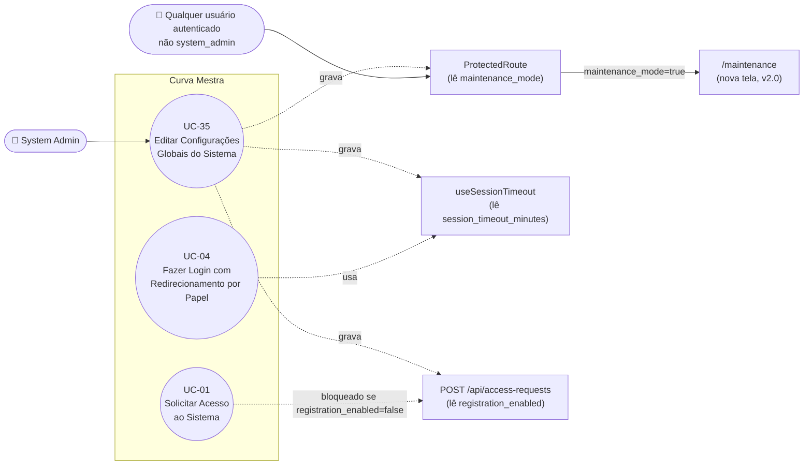

# UC-35: Editar Configurações Globais do Sistema

**Projeto:** Curva Mestra
**Data de Criação:** 15/07/2026
**Autor:** Guilherme Scandelari (via uml-use-case-writer)
**Status:** Aprovado
**Módulo/Contexto:** Administração do Sistema (Configurações Globais)
**Versão:** 2.1

> Um System Admin visualiza e edita três parâmetros globais da plataforma — tempo de expiração de sessão, modo de manutenção e permissão de novos registros — em um único formulário (`/admin/settings`), persistidos em um documento singleton `system_settings/global`. **Até a v1.0, nenhum dos três parâmetros era efetivamente lido/aplicado em nenhum outro ponto do sistema** (achado crítico confirmado por busca exaustiva). **A partir da v2.0 (commit `66c75fa`), os três parâmetros passaram a ter consumidores reais:** `maintenance_mode`/`maintenance_message` agora bloqueiam qualquer usuário não-`system_admin` via `ProtectedRoute` (redirecionamento para a nova tela `/maintenance`); `registration_enabled` agora é validado por `POST /api/access-requests`, bloqueando novas solicitações quando desativado; e `session_timeout_minutes` agora é lido por `useSessionTimeout.ts` uma vez por sessão, com fallback para 15 minutos caso o campo não exista ou seja inválido. Esta tela deixou de ser uma funcionalidade desconectada do restante da plataforma. **A partir da v2.1 (correção do UX-046, PRs #417/#418, merge `b9cd6eb` em `develop`)**, a tela só permite editar e salvar sobre uma leitura confirmada pelo servidor (`getDocFromServer`): falha de leitura vira um estado de erro com "Tentar novamente" e sem formulário; "nenhuma configuração salva ainda" é tratado à parte; a gravação passou a ser feita em transação com checagem de `updated_at` (alteração concorrente é detectada e recusada) e com `merge: true`, só com os campos editáveis; e as mensagens de erro desta tela passaram a ser em pt-BR.

---

## 1. Diagrama UML (Mermaid)

---

## 2. Atores

### 2.1 Ator Primário
**System Admin** — tela restrita por `ProtectedRoute allowedRoles: ['system_admin']` (`src/app/(admin)/layout.tsx`). Único tipo de usuário com acesso a esta tela de edição.

### 2.2 Atores Secundários / Sistemas Externos
Nenhum sistema externo envolvido na própria tela de edição. Não há Firebase Auth adicional, e-mail, nem API route intermediando a gravação — a única "camada" de proteção é a regra de segurança do Firestore (`allow write: if isSystemAdmin()`), avaliada no momento da escrita (desde a v2.1, a escrita ocorre dentro de uma transação do client SDK, `runTransaction`, coberta pelas mesmas regras: `read: isAuthenticated()` para o `tx.get` e `write: isSystemAdmin()` para o `tx.set`). **A partir da v2.0**, os valores gravados por este UC passam a ser lidos, do lado do consumo, por: `ProtectedRoute` (qualquer usuário autenticado não-`system_admin`), `useSessionTimeout.ts` (qualquer usuário autenticado) e `POST /api/access-requests` (visitante não autenticado que solicita acesso, UC-01) — esses consumidores não são "atores" deste caso de uso (não interagem com esta tela), mas são apresentados no diagrama para refletir a relação funcional agora real com UC-04 e UC-01.

---

## 3. Pré-condições
- System Admin autenticado, com custom claim `is_system_admin === true` e `active === true`.
- O documento `system_settings/global` pode ou não existir. **[v2.1]** A tela distingue três situações na leitura: documento existente (formulário com os valores salvos), documento inexistente **confirmado pelo servidor** (formulário com os valores padrão e aviso informativo; salvar cria o documento — Fluxo Alternativo 7c, RN-09) e **falha de leitura** (edição e salvamento bloqueados — Fluxo de Exceção 8c). Só as duas primeiras permitem salvar.
- O navegador do System Admin precisa alcançar o servidor do Firestore: a leitura usa `getDocFromServer`, que nunca responde do cache local (RN-09).

---

## 4. Pós-condições

### 4.1 Sucesso
- **[CORRIGIDO em v2.1]** O documento `system_settings/global` é criado ou atualizado dentro de uma transação (`runTransaction`) que primeiro confirma que ele não foi alterado desde a leitura (RN-01). A gravação usa `tx.set(..., { merge: true })` e envia **exatamente seis campos**: `session_timeout_minutes`, `maintenance_mode`, `maintenance_message`, `registration_enabled`, `updated_by` (uid do admin) e `updated_at` (`serverTimestamp()`). O campo `id` deixou de ser gravado; campos que a tela não conhece (inclusive o `id: 'global'` legado de documentos gravados antes da v2.1) são preservados pelo `merge`.
- Um registro de auditoria é gravado (`writeAdminAuditLog`, `entity_type: 'system_settings'`, `entity_id: 'global'`, `action: 'update'`, descrição "Configurações globais do sistema atualizadas") somente depois da gravação confirmada.
- Sistema exibe toast "Sucesso" / "Configurações salvas com sucesso" e relê o documento em segundo plano (sem o spinner de página inteira), para atualizar a base de `updated_at` usada na próxima checagem de concorrência. Não há redirecionamento — o admin permanece na própria tela `/admin/settings`.
- **[CORRIGIDO em v2.0, commit `66c75fa`]** Diferente das versões anteriores, a alteração salva aqui **agora produz efeito real e observável** em outras partes do sistema:
  - Se `maintenance_mode` for alterado para `true`, qualquer usuário autenticado com `role !== 'system_admin'` passa a ser redirecionado para `/maintenance` na próxima verificação de acesso feita por `ProtectedRoute` (RN-04).
  - Se `registration_enabled` for alterado para `false`, `POST /api/access-requests` passa a rejeitar novas solicitações com 403 (RN-05).
  - Se `session_timeout_minutes` for alterado, o novo valor passa a ser aplicado por `useSessionTimeout.ts` na próxima vez que cada usuário autenticado carregar a aplicação (o valor é lido uma única vez por sessão já em andamento — ver RN-06 para a limitação de propagação em tempo real).

### 4.2 Falha (Garantias Mínimas)
- Se a validação de `session_timeout_minutes` falhar (fora do intervalo 1–1440): nenhuma alteração é persistida.
- **[v2.1]** Se a leitura de `system_settings/global` falhar: nada é gravado — o formulário e o botão "Salvar Configurações" não são exibidos, e `handleSave` recusa a execução mesmo se chamado (guarda `canSaveSystemSettings`). A configuração real em vigor permanece intacta.
- **[v2.1]** Se for detectada alteração concorrente (o documento mudou desde a leitura): nada é gravado e nenhum registro de auditoria é escrito; a alteração feita na outra sessão permanece intacta.
- Se a gravação falhar (rede, permissão): nenhuma alteração é persistida e nenhum registro de auditoria é escrito; o formulário permanece com os valores que o admin havia digitado (não reverte para os valores salvos anteriormente).

---

## 5. Gatilho (Trigger)
System Admin acessa `/admin/settings` (via navegação lateral do Admin Layout) com a intenção de consultar ou alterar os parâmetros globais da plataforma.

---

## 6. Fluxo Principal (Basic Flow)

1. System Admin acessa `/admin/settings`.
2. Sistema exibe um spinner de carregamento (`Loader2`) e chama `loadSettings()`: **[v2.1]** `getDocFromServer(doc(db, 'system_settings', 'global'))` — leitura obrigatoriamente confirmada pelo servidor; um resultado só do cache nunca conta como leitura válida (ver Fluxo de Exceção 8c).
3. Se o documento existir, sistema preenche o formulário com os dados salvos, normalizados por `normalizeSystemSettingsForm` para refletir o valor que o sistema efetivamente aplica (RN-10), e guarda a base de revisão `{ exists: true, updatedAt: updated_at }`. Se o servidor confirmar que o documento não existe, ver Fluxo Alternativo 7c.
4. Sistema exibe três cards: "Sessão de Usuários" (input numérico "Tempo de sessão (minutos)", com hint "Valor padrão: 15 minutos. Recomendado: entre 15 e 60 minutos."), "Modo de Manutenção" (switch "Ativar modo de manutenção") e "Registro de Novos Usuários" (switch "Permitir novos registros").
5. System Admin altera o campo "Tempo de sessão (minutos)" (input numérico, `min="1"`, `max="1440"`).
6. System Admin opcionalmente alterna o switch "Ativar modo de manutenção"; se ligado, um campo adicional "Mensagem de manutenção" aparece condicionalmente (ver Fluxo Alternativo 7a).
7. System Admin opcionalmente alterna o switch "Permitir novos registros".
8. System Admin clica em "Salvar Configurações".
9. **[v2.1]** Sistema confirma que o salvamento é permitido (`canSaveSystemSettings`: leitura em estado `loaded` ou `missing` e nenhum salvamento em andamento); caso contrário, `handleSave` retorna sem fazer nada (defesa em profundidade, além de o botão não ser renderizado nos estados de erro e desatualizado). Em seguida, verifica `auth.currentUser` presente (ver Fluxo de Exceção 8a).
10. Sistema valida `session_timeout_minutes` como número inteiro entre 1 e 1440 (`validateSystemSettingsForm`; ver Fluxo de Exceção 8b).
11. **[CORRIGIDO em v2.1]** Sistema executa `runTransaction`: relê `system_settings/global` (`tx.get`), compara existência e `updated_at` com a base de revisão carregada no passo 3 (`hasConcurrentChange`; ver Fluxo de Exceção 8e) e, se não houve alteração, grava `tx.set(ref, { ...buildSystemSettingsPayload(form, uid), updated_at: serverTimestamp() }, { merge: true })` — só os quatro campos editáveis, `updated_by` e `updated_at` (RN-01).
12. Sistema grava o registro de auditoria (`writeAdminAuditLog`), exibe toast "Sucesso" / "Configurações salvas com sucesso" e relê o documento em segundo plano (`loadSettings({ silent: true })`) para atualizar a base de revisão — se essa releitura falhar, a tela vai para o estado de erro do Fluxo de Exceção 8c (a gravação já confirmada não é afetada).
13. Caso de uso é concluído com sucesso; System Admin permanece em `/admin/settings`. **[CORRIGIDO em v2.0]** A partir deste ponto, os três valores salvos passam a ser efetivamente consumidos: `maintenance_mode`/`maintenance_message` por `ProtectedRoute` (RN-04), `registration_enabled` por `POST /api/access-requests` (RN-05), e `session_timeout_minutes` por `useSessionTimeout.ts` na próxima carga de sessão de cada usuário (RN-06).

---

## 7. Fluxos Alternativos

### 7a. Ativar modo de manutenção e preencher mensagem (a partir do passo 6)
1. System Admin liga o switch "Ativar modo de manutenção" (`maintenance_mode: true`).
2. Sistema exibe o campo "Mensagem de manutenção" (input de linha única, placeholder "Ex: Sistema em manutenção. Retornaremos em breve.").
3. System Admin preenche (opcionalmente) a mensagem.
4. Se o admin desligar o switch novamente antes de salvar, o campo desaparece da tela, mas o valor digitado permanece no estado interno do formulário (não é limpo) — se salvo mais tarde com o switch ligado novamente, a mensagem antiga reaparece (RN-07 na v1.0; renumerada, ver RN-03).
5. Retorna ao passo 7 do Fluxo Principal.

### 7b. Cancelar sem salvar
1. Em qualquer momento antes de clicar em "Salvar Configurações", System Admin clica em "Cancelar".
2. Sistema navega para `/admin/dashboard` (`router.push`), sem nenhuma confirmação e sem persistir nenhuma alteração feita na tela.
3. Caso de uso é encerrado sem efeito.

### 7c. Nenhuma configuração salva ainda (a partir do passo 3) — [novo em v2.1]
1. O servidor confirma que `system_settings/global` não existe (leitura bem-sucedida, estado `missing`).
2. Sistema preenche o formulário com os padrões `DEFAULT_SYSTEM_SETTINGS_FORM` (`session_timeout_minutes: 15`, `maintenance_mode: false`, `maintenance_message: ''`, `registration_enabled: true`) e guarda a base de revisão `{ exists: false, updatedAt: null }`.
3. Sistema exibe, acima dos três cards editáveis, um aviso informativo (`Alert` padrão) com título "Nenhuma configuração salva ainda" e texto "Os valores abaixo são os padrões aplicados hoje pelo sistema. Ao salvar, eles passam a ficar registrados."
4. O botão "Salvar Configurações" fica disponível; o caso de uso retorna ao passo 4 do Fluxo Principal. Ao salvar, o documento é criado com os seis campos do passo 11 (RN-09). Se outro admin criar o documento enquanto esta tela está aberta, o salvamento cai no Fluxo de Exceção 8e.

---

## 8. Fluxos de Exceção

### 8a. Usuário não autenticado ao salvar (a partir do passo 9)
1. `auth.currentUser` ausente no momento de salvar (cenário defensivo — a tela já é protegida por `ProtectedRoute`, mas a checagem existe no client independentemente disso).
2. Sistema exibe toast "Erro" / "Você precisa estar autenticado"; nenhuma chamada ao Firestore é feita.

### 8b. Tempo de sessão fora do intervalo válido (a partir do passo 10)
1. `session_timeout_minutes` é menor que 1 ou maior que 1440.
2. Sistema exibe toast "Erro de validação" / "O timeout deve estar entre 1 e 1440 minutos (24 horas)"; nenhuma chamada ao Firestore é feita.
3. Caso de uso retorna ao passo 5.

### 8c. Falha ao carregar configurações (a partir do passo 2, ou da releitura do passo 12) — [CORRIGIDO em v2.1, UX-046]
1. `getDocFromServer` falha (rede indisponível, servidor inalcançável, permissão negada, token expirado etc.).
2. Sistema registra o detalhe técnico em `console.error` e entra no estado `error` — **sem toast**: o erro fica persistente na própria tela.
3. Sistema exibe um `Alert` destrutivo com título "Não foi possível carregar as configurações", o texto "As configurações em vigor não foram lidas. Para não substituí-las por engano, a edição fica bloqueada até a leitura dar certo.", a mensagem em pt-BR correspondente ao código do erro (`translateFirestoreError`) e o botão "Tentar novamente".
4. Os três cards de configuração (Sessão, Manutenção, Registro) e o botão "Salvar Configurações" **não são renderizados**; a barra de ações mostra só "Cancelar". O card "Integridade de Custom Claims" continua visível e funcional (não depende de `system_settings`).
5. System Admin clica em "Tentar novamente": sistema repete a leitura (volta ao passo 2). Se der certo, o formulário aparece com os valores reais (passo 3) ou com o aviso do Fluxo Alternativo 7c; se falhar de novo, o estado de erro permanece. Não há retentativa automática — logo após a rede voltar, a primeira tentativa pode falhar de novo por causa do tempo de reconexão do SDK.
6. Nenhuma alteração é gravada em `system_settings/global` enquanto a tela estiver neste estado.

> **Antes da v2.1:** a falha de leitura mostrava só um toast efêmero com `error.message` cru e liberava o formulário com os valores padrão do código — o mesmo estado visual de "documento inexistente". Um clique em "Salvar" gravava esses padrões por cima da configuração real (podendo desligar uma manutenção ativa ou reabrir o cadastro). Achado `UX-046` (Alta).

### 8d. Falha ao salvar (a partir do passo 11)
1. A transação de gravação falha por motivo diferente de conflito concorrente (rede, permissão negada por token expirado, etc.).
2. **[CORRIGIDO em v2.1]** Sistema registra o detalhe técnico em `console.error` e exibe toast "Erro ao salvar" com a mensagem em pt-BR correspondente ao código do erro (`translateFirestoreError`), sem `error.message` cru; nenhuma alteração é persistida no Firestore, nenhum registro de auditoria é escrito, e o formulário permanece com os valores que o admin havia digitado na tela (não há reversão para os últimos valores salvos).

### 8e. Conflito de alteração concorrente (a partir do passo 11) — [novo em v2.1]
1. Dentro da transação, a releitura de `system_settings/global` mostra existência ou `updated_at` diferentes da base de revisão carregada (ex.: outra aba ou outro System Admin salvou depois que esta tela leu o documento; ou o documento foi criado/apagado nesse intervalo).
2. Sistema aborta a transação: **nada é gravado** e **nenhum registro de auditoria** é escrito; nenhum toast é exibido.
3. Sistema entra no estado `stale` e exibe um `Alert` destrutivo com título "As configurações foram alteradas em outra sessão", o texto "Outra alteração foi salva enquanto esta tela estava aberta. Recarregue para ver os valores atuais; o que você digitou aqui será descartado." e o botão "Recarregar configurações".
4. Os três cards e o botão "Salvar Configurações" deixam de ser renderizados; a barra de ações mostra só "Cancelar"; o card "Integridade de Custom Claims" continua visível.
5. System Admin clica em "Recarregar configurações": sistema repete a leitura (passo 2), descartando o que havia sido digitado; o caso de uso continua a partir do passo 3 com os valores atuais.

---

## 9. Regras de Negócio Relacionadas

| ID | Regra | Justificativa |
|----|-------|----------------|
| RN-01 | **[CORRIGIDO em v2.1, decisão D1 do usuário em 21/10/2026]** O documento `system_settings/global` é um singleton — sempre o mesmo id fixo (`"global"`). Até a v2.0, ele era **sobrescrito por inteiro** a cada salvamento (`setDoc` sem `merge: true`, gravando também o campo `id`), e, com duas telas abertas (de dois admins ou duas abas do mesmo admin), o último a salvar sobrescrevia integralmente as mudanças do outro, sem detecção de conflito. **Desde a v2.1:** (a) a gravação envia só os quatro campos editáveis + `updated_by` + `updated_at`, com `merge: true` (campos desconhecidos são preservados; `id` não é mais gravado); (b) a gravação ocorre em `runTransaction`, que relê o documento e compara existência e `updated_at` com a base de revisão lida ao carregar a tela (`hasConcurrentChange`) — se forem diferentes, nada é gravado nem auditado e a tela vai para o estado "desatualizado" (Fluxo de Exceção 8e). Não há campo novo de versão: a checagem usa o `updated_at` já existente; documento sem `updated_at` dos dois lados conta como "sem alteração". | Confirmado por leitura de `handleSave` em `src/app/(admin)/admin/settings/page.tsx` (`runTransaction` + `tx.get` + `hasConcurrentChange` + `tx.set(..., { merge: true })`) e de `hasConcurrentChange`/`buildSystemSettingsPayload` em `src/lib/systemSettings.ts`. Coberto pelos cenários 3, 4 e 5 do caderno `tests/e2e/UC-35-editar-configuracoes-globais-do-sistema.spec.ts`. |
| RN-02 | O campo "Tempo de sessão (minutos)" tem uma peculiaridade de UX: o `onChange` aplica `parseInt(e.target.value) || 15` a cada tecla digitada — como `0` é um valor falsy em JavaScript, digitar `"0"` no campo faz o próprio input exibir `15` imediatamente (antes mesmo de clicar em "Salvar" e passar pela validação do passo 10), diferente de qualquer outro valor inválido (ex.: negativo, ou maior que 1440), que só é barrado no momento do salvamento. | Confirmado por leitura de `onChange` do input `session_timeout`: `session_timeout_minutes: parseInt(e.target.value) || 15`. |
| RN-03 | O campo "Mensagem de manutenção" só é exibido na interface quando `maintenance_mode === true`, mas seu valor não é limpo ao desligar o switch — permanece no estado do formulário e é resalvo se o switch for religado antes de clicar em "Salvar" (ver Fluxo Alternativo 7a). | Confirmado por leitura do componente: `{settings.maintenance_mode && (<Input ... value={settings.maintenance_message} />)}`, sem reset do campo no `onCheckedChange` do switch. |
| RN-04 | **[CORRIGIDO em v2.0, commit `66c75fa`]** Até a v1.0, `maintenance_mode` e `maintenance_message` não eram lidos por nenhuma outra tela, componente, rota de API ou Cloud Function do sistema (achado crítico confirmado por busca exaustiva). O commit `66c75fa` adicionou, em `src/components/auth/ProtectedRoute.tsx`, um novo bloco no `useEffect`/`checkAccess`, logo após a checagem de `requirePasswordChange`: para qualquer usuário autenticado com `claims.role !== 'system_admin'`, busca `system_settings/global` via `getDoc`; se `maintenance_mode === true`, redireciona para a nova tela `/maintenance` (`src/app/maintenance/page.tsx`, que exibe `maintenance_message` — com fallback para uma mensagem padrão se vazia — e um botão "Sair da Conta", no mesmo padrão visual de `/suspended/admin`/`/suspended/user`). Um estado `maintenanceBlocked` (via `useState`) foi adicionado com guard de renderização espelhado (`if (maintenanceBlocked) return null`), já que a checagem é assíncrona (busca no Firestore) e não está disponível sincronamente em `claims` como as outras checagens do componente. **`system_admin` nunca é bloqueado pelo modo de manutenção** — pode continuar administrando o sistema mesmo com o modo ativo. Ativar o "Modo de Manutenção" nesta tela agora efetivamente bloqueia o acesso de qualquer usuário não-admin, conforme o texto da própria tela já afirmava. | Corrigido conforme diff de `src/components/auth/ProtectedRoute.tsx` (novo bloco de checagem de `maintenance_mode` e estado `maintenanceBlocked`) e novo arquivo `src/app/maintenance/page.tsx`, ambos no commit `66c75fa`. |
| RN-05 | **[CORRIGIDO em v2.0, commit `66c75fa`]** Até a v1.0, `registration_enabled` não era lido por nenhuma outra tela ou rota (achado crítico confirmado por busca exaustiva, incluindo `register/page.tsx` e `api/access-requests/route.ts`). O commit `66c75fa` adicionou, em `src/app/api/access-requests/route.ts`, antes da validação de campos obrigatórios, um novo bloco que busca `system_settings/global` e, se `registration_enabled === false`, retorna `403` com `{ error: 'O cadastro de novas solicitações está temporariamente desativado.' }`. **Nota de escopo:** a correção foi feita apenas no lado do servidor (validação real da regra de negócio); o formulário `/register` (client, UC-01) **não** recebeu uma checagem espelhada de UX — o visitante ainda pode preencher o formulário inteiro e só descobre que o cadastro está desativado ao submeter, recebendo o erro 403. Isso é registrado como uma melhoria de UX possível para o futuro (seção 14), não um gap de segurança, já que a regra de negócio real (impedir a criação do registro) está corretamente aplicada no servidor. **[Correção de imprecisão em v2.1]** Até a v2.0 este UC dizia que a leitura era feita "via `getDoc` (client SDK)". O código atual lê pelo **Admin SDK** — `adminDb.doc('system_settings/global').get()` (`route.ts:50`) —, que ignora as regras do Firestore; isso é necessário porque a rota é pública (visitante não autenticado) e a regra de leitura de `system_settings` exige `isAuthenticated()`. O bloqueio só ocorre se o documento existir e `registration_enabled === false`. | Corrigido conforme diff de `src/app/api/access-requests/route.ts` no commit `66c75fa` — novo bloco de checagem de `registration_enabled` antes da validação de campos obrigatórios. Forma de leitura (Admin SDK) reconferida em v2.1 em `route.ts:45-56`. |
| RN-06 | **[CORRIGIDO em v2.0, commit `66c75fa`]** Até a v1.0, `session_timeout_minutes` era salvo neste formulário, mas o mecanismo real de expiração de sessão por inatividade (`useSessionTimeout.ts`, consumido em UC-04) usava uma constante fixa `sessionTimeoutMinutes = 15` no próprio código, sem nenhuma leitura de `system_settings/global` (achado crítico). O commit `66c75fa` substituiu essa constante fixa por um `useRef` (`sessionTimeoutMinutesRef`, inicializado com a constante `DEFAULT_SESSION_TIMEOUT_MINUTES = 15` como fallback), preenchido uma vez por sessão — dentro do `useEffect` que roda quando `currentUser` muda, antes de iniciar o timer — com o valor de `system_settings/global.session_timeout_minutes`; se o documento/campo não existir ou não for um número positivo (`typeof configured === 'number' && configured > 0`), mantém o fallback de 15. O `setTimeout` de `resetTimeout()` passou a usar `sessionTimeoutMinutesRef.current` em vez da constante fixa. **Limitação remanescente:** o valor é lido apenas uma vez, no início de cada sessão (quando `currentUser` muda) — se o System Admin alterar `session_timeout_minutes` enquanto um usuário já está com uma sessão ativa, essa sessão em andamento não é afetada; o novo valor só se aplica a partir da próxima vez que o usuário autenticar/recarregar a aplicação. **Cross-referência:** UC-04 (RN-07) documenta o mesmo hardcode como um achado — essa regra passa a estar desatualizada e **UC-04 precisa ser atualizado separadamente** para refletir que o valor agora é configurável (pendência registrada na seção 14, fora do escopo desta atualização). | Corrigido conforme diff de `src/hooks/useSessionTimeout.ts` no commit `66c75fa` — `sessionTimeoutMinutesRef` substituindo a constante fixa, leitura de `system_settings/global.session_timeout_minutes` dentro de `init()`, com fallback de 15 minutos. |
| RN-07 | A regra de segurança do Firestore permite a **leitura** de `system_settings/{settingId}` a **qualquer usuário autenticado**, de qualquer role e tenant (`allow read: if isAuthenticated()`), não apenas ao `system_admin` — apenas a **escrita** é restrita (`allow write: if isSystemAdmin()`). **[Relevância confirmada em v2.0]** Diferente da v1.0 (quando nenhum consumidor lia esta coleção e o impacto era apenas teórico), essa permissão ampla de leitura agora é **efetivamente exercida**: `ProtectedRoute` (RN-04) e `useSessionTimeout.ts` (RN-06) leem `system_settings/global` do lado do client para qualquer usuário autenticado, independentemente do role — exatamente o cenário que este UC já havia previsto como "passaria a ser relevante caso algum consumidor pretendido venha a ser implementado". A permissão de leitura ampla continua sendo a correta para esses dois consumidores (ambos precisam ler antes da autenticação de role ser avaliada). (`POST /api/access-requests`, RN-05, lê pelo Admin SDK e não depende desta regra.) **[v2.1]** A correção do UX-046 não alterou esta regra nem a leitura ampla — `UC-35-RN-07` continua em aberto (§14 item 6); a nova leitura da tela (`getDocFromServer` e `tx.get`) é coberta por ela sem mudanças. | Confirmado em `firestore.rules`, bloco `match /system_settings/{settingId}` — `allow read: if isAuthenticated();` / `allow write: if isSystemAdmin();` (regra não alterada pelo commit `66c75fa`, apenas seu uso real passou a existir). |
| RN-08 | Assim como em UC-31/UC-33, toda a validação de formato (intervalo de `session_timeout_minutes`) e a autorização desta operação de **edição** dependem inteiramente do client (`admin/settings/page.tsx`) e da regra `allow write: if isSystemAdmin()` do Firestore — não há rota `/api/settings` nem Cloud Function revalidando os dados de escrita. (Isso é distinto da leitura feita pelos novos consumidores de RN-04/RN-05/RN-06, que ocorre no server em `POST /api/access-requests`, via Admin SDK, e no client em `ProtectedRoute`/`useSessionTimeout`.) **[v2.1]** A correção do UX-046 manteve esta característica: as novas guardas (bloqueio em falha de leitura, checagem de concorrência) também ficam no client. | Confirmado pela ausência de qualquer rota em `src/app/api/settings/` (não existe) e por leitura completa de `admin/settings/page.tsx`, que grava direto no Firestore via client SDK. |
| RN-09 | **[Nova em v2.1, UX-046]** Só se salva sobre uma base lida do servidor nesta montagem da tela: estado `loaded` (documento existente) ou `missing` (documento inexistente confirmado pelo servidor). Falha de leitura (`error`) e conflito detectado (`stale`) bloqueiam o salvamento, tanto na interface (cards e botão não renderizados) quanto em `handleSave` (guarda `canSaveSystemSettings`). "Documento inexistente" é um estado legítimo: todos os consumidores já aplicam os mesmos padrões quando o documento não existe, então criá-lo com esses padrões não muda o comportamento do sistema. A leitura usa `getDocFromServer`, para que uma resposta só do cache (ex.: navegador offline) nunca seja confundida com "documento inexistente". | Confirmado em `src/app/(admin)/admin/settings/page.tsx` (`loadSettings`, `showForm`, guarda no início de `handleSave`) e em `canSaveSystemSettings` (`src/lib/systemSettings.ts`). Spec `ONLY_FOR_DEVS/TASK_COMPLETED/BUGFIX-admin-settings-sobrescrita-falha-leitura.md` §3.3 (RN-01/RN-02 do spec). |
| RN-10 | **[Nova em v2.1]** Ao carregar um documento existente, a tela exibe cada campo como o sistema efetivamente o aplica, espelhando o fallback de cada consumidor: `session_timeout_minutes` só é mantido se for número finito maior que 0, senão aparece 15 (mesma regra de `useSessionTimeout`; um valor acima de 1440 é exibido e barrado na validação ao salvar); `maintenance_mode` só aparece ligado se for exatamente `true` (mesma regra de `ProtectedRoute`); `registration_enabled` só aparece desligado se for exatamente `false` (mesma regra de `/api/access-requests`); `maintenance_message` vira `''` se ausente ou não for texto. | Confirmado em `normalizeSystemSettingsForm` (`src/lib/systemSettings.ts`), coberto por testes Jest em `src/__tests__/systemSettings.test.ts`. |

---

## 10. Requisitos Especiais / Não Funcionais

| ID | Descrição | Categoria |
|----|-----------|-----------|
| RNF-01 | **[RESOLVIDO em v2.0, commit `66c75fa`]** RN-04, RN-05 e RN-06 descreviam, até a v1.0, uma funcionalidade inteira (a tela de Configurações do Sistema) que não produzia nenhum efeito observável na plataforma. Os três consumidores reais foram implementados; o risco de confiança do produto associado a essa desconexão está resolvido. Permanece como observação (seção 14) a limitação de propagação em tempo real de `session_timeout_minutes` para sessões já em andamento (RN-06) e a ausência de checagem espelhada de UX para `registration_enabled` no formulário `/register` (RN-05). | Confiabilidade / Risco de Produto |
| RNF-02 | Ausência de confirmação antes de alternar o switch "Ativar modo de manutenção" — **agora que essa ativação tem efeito real (RN-04, v2.0)**, o risco de uma ativação acidental bloquear o acesso de todos os usuários não-admin da plataforma é maior do que era na v1.0 (quando o switch não tinha efeito algum). Recomenda-se reavaliar a prioridade desta melhoria de UX. | Usabilidade |
| RNF-03 | Ausência de indicador de "alterações não salvas" — o botão "Cancelar" (Fluxo Alternativo 7b) descarta qualquer alteração feita na tela sem nenhuma confirmação. | Usabilidade |
| RNF-04 | **[CORRIGIDO em v2.1 nesta tela — UX-023 parcial]** Até a v2.0, mensagens de erro do Firestore eram exibidas cruas (`error.message`), sem tradução — mesmo padrão já registrado em UC-09, UC-31/32 e UC-33/34. Desde a v2.1, nenhum `error.message` é exibido em `/admin/settings`: falha de leitura e falha ao salvar usam título fixo em pt-BR + `translateFirestoreError(error.code)`; a falha na verificação de integridade de claims usa a mensagem fixa "Não foi possível verificar a integridade agora. Tente novamente em instantes." (erros de `httpsCallable` têm prefixo `functions/`, fora do tradutor). O detalhe técnico vai para `console.error`. O achado `UX-023` continua aberto para as demais telas (Documentos Legais, Suspender, Termos, Alertas). | Usabilidade |
| RNF-05 | **[Nova em v2.1]** A tela depende de conexão com o servidor do Firestore para editar: offline, ela fica no estado de erro (Fluxo de Exceção 8c). Comportamento intencional — editar configuração global sem os dados reais é exatamente o risco eliminado pelo UX-046. A gravação faz uma leitura extra (transação) e uma releitura após salvar; custo desprezível para uma tela de uso raro (seção 11). | Disponibilidade / Integridade de dados |

---

## 11. Frequência de Uso
Rara — parâmetros globais da plataforma tendem a ser configurados uma única vez ou ajustados esporadicamente, não como parte do uso rotineiro do sistema.

---

## 12. Casos de Uso Relacionados
- **UC-04 (Fazer Login com Redirecionamento por Papel)** — cita `useSessionTimeout.ts` como mecanismo externo de timeout de sessão. **[Relação agora real, v2.0]** O valor configurado aqui (`session_timeout_minutes`) passou a ser lido por `useSessionTimeout.ts` (RN-06, `[CORRIGIDO]`), com fallback de 15 minutos — diferente da v1.0, quando o valor era sempre fixo. **Pendência explícita:** UC-04 (RN-07 daquele documento) ainda descreve o timeout como hardcoded em 15 minutos e precisa ser atualizado separadamente para refletir esta correção — atualização fora do escopo desta tarefa.
- **UC-01 (Solicitar Acesso ao Sistema)** — o campo `registration_enabled` desta tela agora bloqueia efetivamente o fluxo de solicitação de acesso mapeado em UC-01 (RN-05, `[CORRIGIDO]`), via `POST /api/access-requests`, que passou a checar esse campo antes de qualquer validação de formulário. O formulário client `/register` não recebeu uma checagem espelhada de UX (nota de escopo em RN-05) — UC-01 pode se beneficiar de uma atualização futura descrevendo esse novo fluxo de exceção (403), mas isso não foi feito nesta tarefa.
- **[Novo, v2.0]** Uma tela `/maintenance` (`src/app/maintenance/page.tsx`) foi criada como consequência direta de RN-04 — não mapeada como UC dedicado nesta atualização, mas candidata a um UC próprio futuro (ex.: "Visualizar Tela de Manutenção").
- **UC-53 (Consultar e Exportar Trilha de Auditoria)** — o salvamento bem-sucedido gera registro de auditoria (`entity_type: 'system_settings'`); desde a v2.1, conflito concorrente e falha de gravação comprovadamente não geram registro (cenário 5 do caderno).
- Não há relação `<<include>>`/`<<extend>>` formal com nenhum outro UC já documentado.

---

## 13. Referências
- `src/app/(admin)/admin/settings/page.tsx` (reescrito em v2.1: estados `loading`/`loaded`/`missing`/`error`/`stale`, `getDocFromServer`, transação com checagem de `updated_at`, mensagens em pt-BR)
- `src/lib/systemSettings.ts` (novo em v2.1: `DEFAULT_SYSTEM_SETTINGS_FORM`, `normalizeSystemSettingsForm`, `validateSystemSettingsForm`, `hasConcurrentChange`, `buildSystemSettingsPayload`, `canSaveSystemSettings`) e `src/__tests__/systemSettings.test.ts` (testes Jest dessas funções)
- `src/lib/firestoreErrors.ts` (`translateFirestoreError`, reutilizado em v2.1)
- **Caderno de teste automatizado:** `tests/e2e/UC-35-editar-configuracoes-globais-do-sistema.spec.ts` (criado em v2.1, primeiro caderno deste UC; Playwright + Firebase Emulator Suite) — cenários: (1) falha de leitura bloqueia formulário e salvamento; (2) "Tentar novamente" recupera os valores reais; (3) documento inexistente mostra os padrões e salvar cria o documento só com os seis campos; (4) `merge` preserva campo desconhecido; (5) conflito concorrente não grava, não reverte e não audita. A falha de leitura é simulada abortando na rede as requisições do navegador ao emulador (`page.route('**/google.firestore.v1.Firestore/**', route => route.abort())`, decisão D2 do usuário em 21/10/2026) — injeção de falha de rede, sem dado falso. `beforeEach`/`afterEach` apagam `system_settings/global` para não afetar os demais specs.
- Spec da correção: `ONLY_FOR_DEVS/TASK_COMPLETED/BUGFIX-admin-settings-sobrescrita-falha-leitura.md` (v1.2, Concluído) — PR #417 (→ `gscandelari_setup`) e PR #418 (→ `develop`, merge `b9cd6eb`); validação manual em `dev-gscandelari.web.app` aprovada pelo usuário nos cinco itens do STEP 6.
- IDs relacionados em `_MAPA-DE-BUGS-E-MELHORIAS.md`: `UX-046` (corrigido em v2.1), `UC-35-RN-01` (corrigido em v2.1), `UC-35-RN-07` (continua aberto), `UX-023` (corrigido só nesta tela; parcial). Padrão de UX: `_PADRAO-UX.md` §2 (estado de erro), §4 (prevenção de erros) e §5 (mensagens).
- `src/types/index.ts` (interface `SystemSettings`)
- `firestore.rules` (`match /system_settings/{settingId}`)
- `src/hooks/useSessionTimeout.ts` (RN-06, `[CORRIGIDO]` no commit `66c75fa` — passou a ler `system_settings/global.session_timeout_minutes`, com fallback de 15 minutos via `DEFAULT_SESSION_TIMEOUT_MINUTES`)
- `src/components/auth/ProtectedRoute.tsx` (RN-04, `[CORRIGIDO]` no commit `66c75fa` — novo bloco de checagem de `maintenance_mode` e estado `maintenanceBlocked`)
- `src/app/maintenance/page.tsx` (novo arquivo, commit `66c75fa` — tela exibida quando `maintenance_mode === true` para usuários não-`system_admin`)
- `src/app/(auth)/register/page.tsx`, `src/app/api/access-requests/route.ts` (RN-05, `[CORRIGIDO]` no commit `66c75fa` — a rota passou a checar `registration_enabled`; o formulário client não recebeu checagem espelhada, nota de escopo)
- `project_doc/admin/settings-documentation.md` — engenharia reversa anterior (08/02/2026); já registrava, na seção "13.3 Testes de Integração", os três itens de verificação como pendências não confirmadas — este UC confirmou, na v1.0, que nenhuma das três passava, e agora confirma, na v2.0, que as três passam a ter efeito real após o commit `66c75fa`.

---

## 14. Perguntas em Aberto / Decisões Pendentes

1. **[RESOLVIDO em v2.0 — commit `66c75fa`]** RN-04, RN-05 e RN-06 — os três consumidores reais foram implementados (`ProtectedRoute`/`/maintenance`, `POST /api/access-requests`, `useSessionTimeout.ts`). A decisão de produto pendente na v1.0 (implementar ou remover a tela) foi resolvida a favor de implementar.
2. **[Pendência explícita, fora do escopo desta tarefa]** UC-04 (RN-07 daquele documento) precisa ser atualizado separadamente para refletir que `session_timeout_minutes` deixou de ser hardcoded — o achado ali registrado não é mais válido após esta correção (RN-06 deste UC).
3. **[Nota de escopo, RN-05]** O formulário `/register` (UC-01) não recebeu uma checagem espelhada de UX para `registration_enabled` — o visitante só descobre que o cadastro está desativado ao submeter o formulário e receber 403. Não é um gap de segurança (a regra real está aplicada no servidor), mas é uma melhoria de UX possível para o futuro.
4. **[RN-06]** `session_timeout_minutes` é lido apenas uma vez por sessão (quando o usuário autentica/recarrega) — uma alteração feita pelo System Admin não afeta sessões já em andamento. Decisão de produto pendente sobre se vale a pena introduzir um mecanismo de propagação em tempo real (ex.: listener `onSnapshot`), dado o custo/benefício frente à baixa frequência de uso desta tela (seção 11).
5. ~~**[RN-01]** Sobrescrita total do documento (`setDoc` sem `merge`) sem detecção de conflito em escrita concorrente — decisão de produto pendente sobre se vale a pena introduzir `merge: true` ou um mecanismo de optimistic locking.~~ **[RESOLVIDO em v2.1 — decisão D1 do usuário em 21/10/2026]** Adotadas as duas medidas: gravação com `merge: true` só dos campos editáveis e checagem otimista de concorrência por `updated_at` dentro de `runTransaction` (RN-01, Fluxo de Exceção 8e). Motivo da decisão: o cenário de duas abas abertas (inclusive do mesmo admin) era real e da mesma classe de dano do UX-046.
6. **[RN-07]** Regra de leitura do Firestore permite a qualquer usuário autenticado (não apenas `system_admin`) ler `system_settings/global` — confirmado, em v2.0, que essa leitura ampla é necessária para os consumidores reais implementados (`ProtectedRoute`, `useSessionTimeout`); mantida sem alteração. **[v2.1]** Continua em aberto (`UC-35-RN-07`): a correção do UX-046 não tocou nas regras do Firestore.
7. **[RN-08]** Mesma decisão já registrada em UC-31/UC-33 sobre introduzir validação server-side (rota `/api/settings` com Admin SDK) para a operação de **edição** deste módulo (distinta da leitura pelos consumidores de RN-04/RN-05/RN-06, já implementada).
8. **[RNF-02]** Ausência de confirmação ao ativar o "Modo de Manutenção" — recomenda-se reavaliar a prioridade desta melhoria de UX agora que a ativação tem efeito real e imediato sobre todos os usuários não-admin.
9. **[v2.1, observação de escopo]** O card "Integridade de Custom Claims" (botão "Verificar agora", Cloud Function `checkClaimsIntegrityOnDemand`) existe nesta mesma tela, mas não é mapeado por este UC nem por nenhum outro UC já documentado. A v2.1 cita o card só onde a correção o afeta (continua disponível em todos os estados de leitura; mensagem de erro em pt-BR). Fica pendente decidir se ele merece UC próprio ou uma seção neste UC.

---

## 15. Histórico de Versões

| Versão | Data | Autor | O que mudou |
|--------|------|-------|--------------|
| 1.0 | 15/07/2026 | Guilherme Scandelari | Versão inicial, investigada do zero a partir de `admin/settings/page.tsx`, `types/index.ts`, `firestore.rules` e `useSessionTimeout.ts`. Confirmado, por busca exaustiva em todo o código-fonte, que esta é uma funcionalidade inteiramente desconectada do restante do sistema: `maintenance_mode`/`maintenance_message` (RN-04), `registration_enabled` (RN-05) e `session_timeout_minutes` (RN-06, ignorado por `useSessionTimeout.ts` que usa valor fixo de 15 minutos) não são lidos por nenhuma outra tela, rota ou Cloud Function. Confirmado 1 único UC agrupando as três configurações, por serem editadas e salvas em um único formulário/ação. Primeiro UC do módulo "Admin — Configurações Globais do Sistema". |
| 2.0 | 24/07/2026 | Guilherme Scandelari | Reestruturação de escopo — correção de três itens de severidade Alta no mesmo commit `66c75fa`: (1) RN-04, `maintenance_mode`/`maintenance_message` agora bloqueiam usuários não-`system_admin` via `ProtectedRoute` + nova tela `/maintenance`; (2) RN-05, `POST /api/access-requests` agora valida `registration_enabled` (com nota de escopo sobre a ausência de checagem espelhada de UX em `/register`); (3) RN-06, `useSessionTimeout.ts` agora lê `session_timeout_minutes` de `system_settings/global` uma vez por sessão, com fallback de 15 minutos, deixando de ser hardcoded. As três regras foram marcadas como `[CORRIGIDO]`; seções 1 (diagrama), 2.2, 4.1, 6 (passo 13), 9, 10 (RNF-01, RNF-02), 12, 13 e 14 foram reescritas para refletir que esta tela deixou de ser uma funcionalidade desconectada. Registrada a pendência explícita de atualizar UC-04 (RN-07 daquele documento) separadamente, já que o achado de hardcode ali documentado deixa de ser válido. |
| 2.1 | 21/10/2026 | Guilherme Scandelari (via uml-use-case-writer) | **Correção do UX-046 (Alta) e do `UC-35-RN-01`** — spec `ONLY_FOR_DEVS/TASK_COMPLETED/BUGFIX-admin-settings-sobrescrita-falha-leitura.md` v1.2, PR #417 (→ `gscandelari_setup`) e PR #418 (→ `develop`, merge `b9cd6eb`), validação manual em `dev-gscandelari.web.app` aprovada pelo usuário. Falha de leitura deixou de liberar o formulário com valores padrão: agora é um estado de erro persistente com "Tentar novamente", sem cards nem botão "Salvar", e `handleSave` recusa a execução (Fluxo de Exceção 8c reescrito, RN-09 nova). Leitura passou a `getDocFromServer`. "Documento inexistente" virou o Fluxo Alternativo 7c, com aviso informativo e criação do documento ao salvar. Gravação passou a `runTransaction` com checagem de `updated_at` (decisão D1 do usuário) e `merge: true` só com os seis campos (sem `id`) — RN-01 `[CORRIGIDO]`, novo Fluxo de Exceção 8e (conflito concorrente: nada gravado, sem auditoria, estado "desatualizado" com "Recarregar configurações"), §14 item 5 `[RESOLVIDO]`. Mensagens de erro em pt-BR, sem `error.message` cru nesta tela — RNF-04 `[CORRIGIDO]` (UX-023 parcial). Novas RN-10 (normalização dos valores lidos) e RNF-05 (dependência de conexão). Corrigida imprecisão da RN-05: `/api/access-requests` lê `system_settings/global` pelo Admin SDK (`route.ts:50`), não pelo client SDK (ajustes correlatos em RN-07 e RN-08). Registrado o primeiro caderno de teste automatizado do UC (`tests/e2e/UC-35-editar-configuracoes-globais-do-sistema.spec.ts`, falha de leitura simulada por `page.route(...).abort()`, decisão D2) e os IDs `UX-046`, `UC-35-RN-01`, `UC-35-RN-07` (continua aberto) e `UX-023` (parcial). Seções alteradas: resumo, 2.2, 3, 4.1, 4.2, 6 (passos 2, 3, 9-12), 7c (nova), 8c, 8d, 8e (nova), 9 (RN-01, RN-05, RN-07, RN-08; RN-09 e RN-10 novas), 10 (RNF-04; RNF-05 nova), 12, 13, 14 (itens 5, 6 e 9 novo) e 15. Status mantido em Aprovado (correção já validada pelo usuário; nenhuma decisão de produto nova). |
