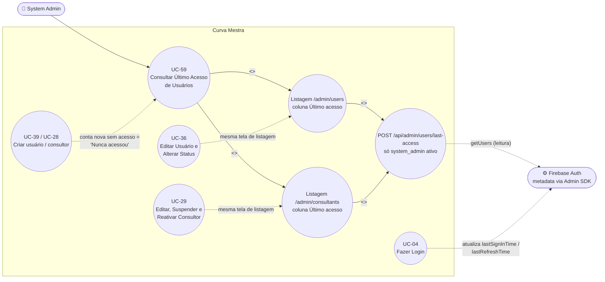

# UC-59: Consultar Último Acesso de Usuários

**Projeto:** Curva Mestra
**Data de Criação:** 19/10/2026
**Autor:** Guilherme Scandelari (via uml-use-case-writer)
**Status:** Implementado
**Módulo/Contexto:** Admin (Usuários e Consultores)
**Versão:** 1.0

> **Implementado — branch `feature/ultimo-acesso-usuarios` (PR #407, mergeado em `gscandelari_setup`, validado em `dev-gscandelari.web.app` em 19/10/2026).** O System Admin vê, nas listagens `/admin/users` e `/admin/consultants`, a coluna **"Último acesso"**, com a última vez que cada usuário ou consultor usou o app. O dado vem do metadata do Firebase Auth (o mais recente entre `lastRefreshTime` e `lastSignInTime`), lido por uma API route com Admin SDK. Nada é gravado: não há escrita no Firestore, nem mudança de rules ou índices. Serve para suporte, acompanhamento de adoção e identificação de contas paradas. Spec de implementação: `ONLY_FOR_DEVS/TASK_COMPLETED/FEAT-ultimo-acesso-usuarios.md` (v1.0, Concluído). Decisões D1 (fonte: metadata do Auth), D2 (só as duas telas do admin) e D3 (máximo entre `lastRefreshTime` e `lastSignInTime`) tomadas pelo usuário (Guilherme Stanke Scandelari).

---

## 1. Diagrama UML (Mermaid)

**Decisão de modelagem — um único UC para as duas telas.** As duas listagens têm o mesmo ator, o mesmo objetivo (saber quem usa o sistema de fato), a mesma fonte de dados, o mesmo hook (`useLastAccess`), a mesma rota e as mesmas regras de exibição. A única diferença é a chave usada para cruzar com o Auth (`users/{uid}` → id do doc; consultor → `consultants.user_id`), tratada como Fluxo Alternativo 7a.

---

## 2. Atores

### 2.1 Ator Primário
**System Admin** (`system_admin`, com claims `is_system_admin === true` e `active === true`) — único ator que vê a coluna "Último acesso" e único autorizado a chamar `POST /api/admin/users/last-access`. Objetivo: saber quais usuários e consultores usam o sistema, para suporte, acompanhamento de adoção e limpeza de contas paradas.

### 2.2 Atores Secundários / Sistemas Externos
- **Firebase Auth (Admin SDK)** — fonte do dado. A rota chama `adminAuth.getUsers([{ uid }, ...])` (até 100 UIDs por chamada) e lê `UserRecord.metadata.lastSignInTime` e `metadata.lastRefreshTime`. UIDs inexistentes voltam em `notFound`.
- **Usuários e consultores listados** (`clinic_admin`, `clinic_user`, `system_admin`, consultor) — não interagem com este UC; o próprio uso do app por eles (login em UC-04 e abertura do app com sessão ativa) é o que atualiza o metadata no Auth.

---

## 3. Pré-condições
- System Admin autenticado, com `is_system_admin === true` e `active === true` nas custom claims (a rota recusa qualquer outro token — RN-05).
- Para `/admin/users`: existir ao menos um documento em `users` que não seja `role === 'clinic_consultant'` (a tela já exclui consultores da lista; eles aparecem só em `/admin/consultants`).
- Para `/admin/consultants`: `GET /api/consultants` retornar ao menos um consultor; para haver dado, o consultor precisa ter `user_id` (UID do Auth) preenchido.
- **Multi-tenant:** não se aplica isolamento por `tenant_id` — é uma visão global (cross-tenant) restrita a system_admin, sem nenhuma query nova no Firestore. A rota lê apenas o Firebase Auth.

---

## 4. Pós-condições

### 4.1 Sucesso (Garantias de Sucesso)
- Cada linha das duas tabelas exibe, na coluna "Último acesso", um de três valores (RN-02): data/hora `dd/mm/aaaa HH:mm` no fuso `America/Sao_Paulo`; "Nunca acessou"; ou "—".
- **Nada é gravado**: nenhuma escrita no Firestore, nenhum registro em `audit_log` (RN-06), nenhuma alteração no Firebase Auth. `firestore.rules`, `firestore.indexes.json` e `storage.rules` não mudam.

### 4.2 Falha (Garantias Mínimas)
- A tabela sempre carrega e funciona normalmente, independente da consulta de último acesso (a busca é feita depois e em paralelo — RNF-01).
- Se a rota falhar (rede, 4xx, 5xx), a coluna fica em "—" nas linhas afetadas, sem toast nem mensagem na tela; o erro vai só para `console.error('[useLastAccess] ...')` (RN-07).
- Nenhum dado de último acesso é exposto a quem não é system_admin ativo (401/403 — RN-05).

---

## 5. Gatilho (Trigger)
System Admin abre `/admin/users` ou `/admin/consultants` (ou muda o filtro de status em `/admin/consultants`, que recarrega a lista).

---

## 6. Fluxo Principal (Basic Flow) — `/admin/users`

1. System Admin acessa `/admin/users`.
2. Sistema carrega a lista de usuários (`loadAllUsers`: coleção `users` pelo client SDK, `orderBy('created_at', 'desc')`, ignorando `role === 'clinic_consultant'`) e renderiza a tabela com as colunas Usuário | Email | Clínica | Role | Status | Cadastro | **Último acesso** | Ações. A coluna "Último acesso" começa com "—" em todas as linhas.
3. Em paralelo, o hook `useLastAccess` recebe os UIDs de **todos** os usuários carregados (`users`, não a lista filtrada pela busca), remove vazios e duplicados e divide em lotes de até 100 (`chunkUids`).
4. Para cada lote, o hook obtém o ID token do System Admin e chama `POST /api/admin/users/last-access` com `Authorization: Bearer {token}` e body `{ "uids": [...] }`. Os lotes rodam juntos (`Promise.allSettled`).
5. A rota valida o token (`verifyBearerToken`), exige `is_system_admin === true && active === true`, valida o body (`parseLastAccessRequest`: 1 a 100 UIDs não vazios, até 128 caracteres cada, duplicados removidos antes de contar) e chama `adminAuth.getUsers`.
6. Para cada usuário encontrado no Auth, a rota calcula o último acesso (`computeLastAccess`, RN-01) e responde `200 { data: { [uid]: ISO 8601 UTC | null } }`, com `Cache-Control: no-store`. UIDs em `notFound` ficam fora de `data`.
7. O hook junta o `data` dos lotes que deram certo num único mapa.
8. Sistema atualiza cada célula "Último acesso" com `formatLastAccessLabel(lastAccess[uid])` (RN-02): data/hora `dd/mm/aaaa HH:mm` (Brasília, 24h, sem vírgula), "Nunca acessou" ou "—".
9. System Admin lê a coluna. A busca por texto da tela filtra as linhas sem disparar nova chamada à rota (o hook depende da lista completa, não da filtrada).
10. Caso de uso é concluído com sucesso.

---

## 7. Fluxos Alternativos

### 7a. Listagem de consultores — `/admin/consultants` (a partir do passo 1)
1. System Admin acessa `/admin/consultants`.
2. Sistema carrega os consultores via `GET /api/consultants` (com o filtro de status selecionado, se houver) e renderiza a tabela com as colunas Código | Nome | Contato | Clínicas | Status | Criado em | **Último acesso** | Ações.
3. O hook `useLastAccess` recebe `consultants.map(c => c.user_id)` — o vínculo com o Auth é pelo campo `consultants.user_id`, **não** pelo id do documento `consultants/{id}`, porque em produção o id é gerado por `.add()` e difere do UID (RN-04).
4. Passos 4 a 8 do Fluxo Principal. Consultor sem `user_id` mostra "—".
5. Trocar o filtro de status recarrega a lista; como o conjunto de UIDs muda, o hook refaz a consulta. A busca por texto não refaz a consulta.

### 7b. Usuário ou consultor que nunca acessou (a partir do passo 6)
1. O UID existe no Auth, mas nem `lastRefreshTime` nem `lastSignInTime` têm valor válido (ex.: conta criada pelo painel em UC-39 ou UC-28 e nunca usada).
2. A rota devolve `null` para esse UID e a célula mostra **"Nunca acessou"**.

### 7c. UID inexistente no Auth (a partir do passo 6)
1. O documento existe no Firestore, mas o UID não existe no Firebase Auth (`notFound`).
2. O UID fica fora de `data` e a célula mostra **"—"** (dado desconhecido — o sistema não afirma "Nunca acessou").

### 7d. Mais de 100 usuários (a partir do passo 3)
1. O hook divide os UIDs em lotes de 100 e faz uma chamada por lote. O mapa final junta todos os lotes que deram certo; linhas de um lote que falhou ficam em "—" (Fluxo de Exceção 8a).

### 7e. Lista vazia ou sem usuário logado no client (a partir do passo 3)
1. Sem nenhum UID (ou sem `auth.currentUser`), o hook não chama a rota e o mapa fica vazio.

---

## 8. Fluxos de Exceção

### 8a. Falha da rota ou da rede (a partir do passo 4)
1. Algum lote falha (erro de rede, 4xx ou 5xx — incluindo o 500 genérico `{ error: 'Erro ao consultar último acesso' }` quando `getUsers` lança).
2. O hook registra `console.error('[useLastAccess] Erro ao buscar último acesso: ...')` e não lança erro. Não há toast nem mensagem na tela.
3. As linhas desse lote ficam em "—"; a tabela e as demais ações (editar, suspender etc.) seguem funcionando.

### 8b. Chamada sem token ou com token inválido (a partir do passo 5)
1. A rota responde **401** (`{ error }` de `verifyBearerToken`), com `Cache-Control: no-store`.

### 8c. Chamada por quem não é system_admin ativo (a partir do passo 5)
1. Token de `clinic_admin`, `clinic_user`, consultor ou de system_admin com `active !== true`.
2. A rota responde **403** `{ error: 'Acesso negado' }`, sem nenhum dado, com `Cache-Control: no-store`. (Na interface isso não ocorre, porque as telas são do layout do admin; o caso cobre chamadas diretas à API.)

### 8d. Body inválido (a partir do passo 5)
1. JSON inválido, `uids` ausente, não-array, vazio, com item não-string, vazio ou com mais de 128 caracteres → **400** `{ error: 'Informe a lista de usuários (uids)' }`.
2. Mais de 100 UIDs únicos → **400** `{ error: 'Máximo de 100 usuários por consulta' }`. (O hook nunca envia mais de 100 por chamada.)

---

## 9. Regras de Negócio Relacionadas

| ID | Regra | Justificativa |
|----|-------|----------------|
| RN-01 | **Último acesso** = o mais recente entre `metadata.lastRefreshTime` e `metadata.lastSignInTime` do `UserRecord` no Firebase Auth. Valores ausentes, vazios ou inválidos são ignorados; sem nenhum valor válido, o resultado é `null`. Como `useAuth` força a renovação do token (`getIdToken(true)`) a cada `onAuthStateChanged`, **abrir o app com sessão ativa conta como acesso** — o rótulo significa "última atividade com o app", não "último login". | Decisão D3 do usuário. Confirmado em `computeLastAccess` (`src/lib/lastAccess.ts`) e `src/hooks/useAuth.ts`. |
| RN-02 | Exibição: `null` → **"Nunca acessou"**; valor ausente do mapa (carregando, falha da rota, UID inexistente no Auth, consultor sem `user_id`) → **"—"**; data válida → `dd/mm/aaaa HH:mm` no fuso `America/Sao_Paulo`, formato 24h, montado por `formatToParts` (sem vírgula). ISO inválido → "—". | Não afirmar "Nunca acessou" quando o dado simplesmente não existe. Confirmado em `formatLastAccessLabel`. |
| RN-03 | A coluna existe **apenas** em `/admin/users` (entre "Cadastro" e "Ações") e `/admin/consultants` (entre "Criado em" e "Ações"). Não aparece na aba de usuários da clínica (`/clinic/...`) nem em nenhuma outra tela. | Decisão D2 do usuário. |
| RN-04 | O consultor é cruzado com o Auth por `consultants.user_id`. O id do documento `consultants/{id}` não é usado (em produção é gerado por `.add()` e difere do UID). | Confirmado em `admin/consultants/page.tsx` e `src/app/api/consultants/route.ts`. |
| RN-05 | A rota `POST /api/admin/users/last-access` responde só a token com `is_system_admin === true && active === true`. | Dado de atividade é pessoal; o padrão de guarda é o mesmo de `src/app/api/tenants/search/route.ts`. |
| RN-06 | A consulta **não** gera trilha de auditoria (`audit_log`) — é só leitura e não altera dado. | Escolha de implementação aceita pelo usuário; mesmo critério das demais listagens administrativas. |
| RN-07 | Falha na consulta de último acesso **não** é exibida ao System Admin: só `console.error`, e as células ficam em "—". | Escolha de implementação aceita pelo usuário (a coluna é complementar e não pode quebrar a listagem). |
| RN-08 | Até **100** UIDs por chamada (limite de `adminAuth.getUsers`). Acima disso, a rota responde 400; o cliente divide em lotes de 100. | Escolha de implementação aceita pelo usuário. |
| RN-09 | A coluna **não** é ordenável nem filtrável. | Escolha de implementação aceita pelo usuário (fora do escopo da feature). |
| RN-10 | O próprio system_admin aparece em `/admin/users` e tem seu último acesso exibido como os demais. | Trade-off aceito na spec (4.3). |

---

## 10. Requisitos Especiais / Não Funcionais

| ID | Descrição | Categoria |
|----|-----------|-----------|
| RNF-01 | A busca de último acesso não bloqueia a renderização da tabela: é feita pelo hook depois que a lista carrega, em paralelo, com "—" até chegar o resultado. Se o componente desmontar ou a lista mudar antes da resposta, o resultado antigo é descartado (flag `cancelled`). | Performance / Usabilidade |
| RNF-02 | Respostas da rota sempre com `Cache-Control: no-store`. O 500 é genérico e não ecoa UIDs nem a mensagem interna; o `console.error` do servidor registra só o erro. | Segurança |
| RNF-03 | A rota usa **POST** (não GET) para não colocar até 100 UIDs na URL nem em logs de acesso. | Segurança |
| RNF-04 | Nenhuma escrita no Firestore e nenhuma mudança em `firestore.rules`, `firestore.indexes.json` ou `storage.rules` — o deploy da feature é só de hosting. | Manutenibilidade / Produção com cliente real |
| RNF-05 | A busca por texto em `/admin/users` e `/admin/consultants` não dispara novas chamadas à rota (o hook usa a lista completa, com chave estável `UIDs únicos ordenados`). | Performance |

---

## 11. Frequência de Uso
Baixa a média — consulta eventual do System Admin, sempre que abre as listagens de usuários ou consultores (suporte, acompanhamento de adoção, revisão de contas paradas). Cada abertura gera de 1 a N/100 chamadas à rota.

**Validação em dev (`dev-gscandelari.web.app`, 19/10/2026):** em `/admin/users`, 5 usuários com data/hora e 33 com "Nunca acessou"; em `/admin/consultants`, 1 de 4 consultores com data/hora; chamada à rota com token de `clinic_admin` → 403.

---

## 12. Casos de Uso Relacionados
- **UC-36 (Editar Usuário e Alterar Status Cross-Tenant)** — mesma tela de listagem `/admin/users`; a coluna "Último acesso" fica ao lado das ações de edição desse UC. Sem relação de `<<include>>`/`<<extend>>`: são objetivos independentes na mesma tela.
- **UC-29 (Editar, Suspender e Reativar Consultor)** — mesma tela de listagem `/admin/consultants`; idem.
- **UC-39 (Criar Usuário Diretamente para Clínica via Painel Admin)** e **UC-28 (Cadastrar Consultor)** — contas criadas por esses UCs aparecem com "Nunca acessou" até o primeiro uso (Fluxo Alternativo 7b).
- **UC-04 (Fazer Login com Redirecionamento por Papel)** — o login (e a abertura do app com sessão ativa) é o que atualiza `lastSignInTime`/`lastRefreshTime` no Auth, fonte deste UC (RN-01).

---

## 13. Referências
- Spec: `ONLY_FOR_DEVS/TASK_COMPLETED/FEAT-ultimo-acesso-usuarios.md` (v1.0, Concluído)
- `src/lib/lastAccess.ts` — `computeLastAccess`, `parseLastAccessRequest`, `chunkUids`, `formatLastAccessLabel`, `LAST_ACCESS_MAX_UIDS`, `LastAccessMap`
- `src/app/api/admin/users/last-access/route.ts` — `POST`, só system_admin ativo
- `src/hooks/useLastAccess.ts` — busca em lotes, `Promise.allSettled`, não bloqueante
- `src/app/(admin)/admin/users/page.tsx` — coluna "Último acesso" (`data-testid="last-access"`)
- `src/app/(admin)/admin/consultants/page.tsx` — coluna "Último acesso" por `consultant.user_id` (`data-testid="last-access"`)
- `src/hooks/useAuth.ts` — `getIdToken(true)` no `onAuthStateChanged` (RN-01)
- `src/lib/services/accessRequestRouteHelpers.ts` — `verifyBearerToken`
- Testes unitários: `src/__tests__/lastAccess.test.ts`, `src/__tests__/lastAccessRoute.test.ts`
- Caderno E2E: `tests/e2e/UC-59-consultar-ultimo-acesso-de-usuarios.spec.ts` — 7 testes: (1) coluna entre "Cadastro" e "Ações" com `dd/mm/aaaa HH:mm` após login do clinic_admin A; (2) usuário criado sem login mostra "Nunca acessou" e a busca não refaz a chamada; (3) rota bloqueada → tabela carrega e coluna fica em "—"; (4) `/admin/consultants` — coluna após "Criado em", consultor com acesso mostra data/hora e consultor recém-criado (id do doc ≠ uid) mostra "Nunca acessou"; (5) rota sem token → 401; (6) token de clinic_admin → 403 sem dados; (7) token de system_admin → 200 com ISO para quem acessou e `null` para quem nunca acessou.

---

## 14. Perguntas em Aberto / Decisões Pendentes

Nenhuma. Todas as decisões (D1–D3) e as escolhas de implementação (falha só em `console.error`, limite de 100 UIDs com 400, sem auditoria da consulta, coluna não ordenável) foram confirmadas pelo usuário.

---

## 15. Histórico de Versões

| Versão | Data | Autor | O que mudou |
|--------|------|-------|--------------|
| 1.0 | 19/10/2026 | Guilherme Scandelari (via uml-use-case-writer) | Versão inicial, as-is da feature `FEAT-ultimo-acesso-usuarios` (PR #407), validada em `dev-gscandelari.web.app` em 19/10/2026. Caderno E2E com 7 testes. |
